# DevOps delivery series (projects 01 to 04)

Four connected projects that follow **one service** from commit to on-call: build and ship it securely,
provision the platform, deploy it with GitOps, then observe it against SLOs. Everything is code, documented,
and tested where the tooling allows. This folder holds the overview, the guide for turning the series into
proof, and the evidence from the test runs; the projects themselves are siblings of this folder.

Source: [`00-end-to-end.mmd`](docs/schematics/00-end-to-end.mmd) · [all schematics](docs/schematics/README.md)

| # | Project | Skills shown | Checked offline |
|---|---|---|---|
| 01 | [Secure CI/CD pipeline](../01-secure-cicd-pipeline) | GitHub Actions, Docker hardening, Trivy, SBOM, cosign, provenance | tests, lint, hadolint, live run |
| 02 | [AWS platform with Terraform](../02-aws-terraform-platform) | IaC modules, VPC, ECS Fargate, ALB, autoscaling, OIDC, remote state | fmt, wiring check |
| 03 | [Kubernetes + GitOps](../03-k8s-gitops) | Kustomize, Argo CD, Pod Security, NetworkPolicy, HPA/PDB, policy-as-code | render, policy tests |
| 04 | [Observability and SLOs](../04-observability-slo) | Prometheus, Alertmanager, Grafana, burn-rate alerts, runbooks, game day | rule unit tests, e2e run |

The four share one small service (`release-tracker`, built in project 01). Projects 02 to 04 depend on its image
or its `/metrics` endpoint, so unlike the other projects in this repository they are meant to be read together.

## Be precise about what is proven
Each project README ends with a **Verification status** table that separates what was actually run from what was not.
Code, unit tests, linters, rule tests and manifest policy checks were run offline. The four GitHub Actions workflows
have run on the pull request and pass (build, smoke test, Trivy gate and SBOM; `tofu validate`, TFLint and Checkov; kubeconform and
policy checks; promtool rule tests). Still unproven: image publish and signing (runs on `main` only), `tofu plan/apply`
against AWS, an Argo CD sync on a real cluster, the Compose stack, and Grafana rendering the dashboard. Anything marked
"Not run" in the tables has not been executed anywhere.

Run everything that is possible offline from the repository root: `./scripts/verify-devops-series.sh`

See [`docs/PORTFOLIO-GUIDE.md`](docs/PORTFOLIO-GUIDE.md) for how to turn this into evidence: screenshots to capture,
resume bullet templates, interview talk tracks and honest limitations to volunteer.
