# Start here

This repository holds **eight components**, grouped into three projects. This folder is the engineer's map:
what each component is, what order to read them in, and what each one actually proves. The components are
siblings of this folder.

> Looking for the reading view rather than the parts list? [`showcase/`](../../showcase) presents the same
> work as the three projects a reviewer meets first.

## Pick a path

**Short on time (10 minutes).** Read project [01](../01-secure-cicd-pipeline) for delivery and
[04](../04-observability-slo) for operations. Between them they show the two halves of the job.

**Reviewing for a role.** Follow the order below. Projects 01 to 04 build on each other; 05 to 08 stand alone.

**Looking for depth in one area.** Jump straight to the project that matches: resilience patterns in
[05](../05-ai-reliability-platform), platform engineering in [06](../06-self-service-platform),
SLO practice in [07](../07-sre-reliability-lab), automated disaster recovery and postmortems in
[08](../08-disaster-recovery-autopilot).

## Projects 01 to 04: one service, end to end

Four connected projects that follow **one service** from commit to on-call: build and ship it securely,
provision the platform, deploy it with GitOps, then observe it against SLOs.



<sub>Source: [`00-end-to-end.mmd`](docs/schematics/00-end-to-end.mmd) · [all schematics](docs/schematics/README.md)</sub>

| # | Project | Skills shown |
|---|---|---|
| 01 | [Secure CI/CD pipeline](../01-secure-cicd-pipeline) | GitHub Actions, Docker hardening, Trivy, SBOM, cosign, provenance |
| 02 | [AWS platform with Terraform](../02-aws-terraform-platform) | IaC modules, VPC, ECS Fargate, ALB, autoscaling, OIDC, remote state |
| 03 | [Kubernetes and GitOps](../03-k8s-gitops) | Kustomize, Argo CD, Pod Security, NetworkPolicy, HPA/PDB, policy-as-code |
| 04 | [Observability and SLOs](../04-observability-slo) | Prometheus, Alertmanager, Grafana, burn-rate alerts, runbooks, game day |

These four share one small service (`release-tracker`, built in project 01). Projects 02 to 04 use its image
or its `/metrics` endpoint, so unlike the rest of the repository they are meant to be read together.

## Projects 05 to 08: deeper dives

Four independent projects, each going further into a single theme. Nothing here depends on the series above.

| # | Project | Skills shown |
|---|---|---|
| 05 | [AI reliability platform](../05-ai-reliability-platform) | Retries with jitter, circuit breaker, fallback, rate limits and budgets, measured outage drill |
| 06 | [Self-service platform](../06-self-service-platform) | Service scaffolding, policy-as-code with rule IDs, service catalog, Terraform environments |
| 07 | [SRE reliability lab](../07-sre-reliability-lab) | SLOs as code, generated burn-rate alerts, incident simulator, chaos experiments, game days |
| 08 | [Disaster recovery autopilot](../08-disaster-recovery-autopilot) | Alert-driven recovery playbooks, PostgreSQL restores proven in a scratch database, data validation, RTO/RPO checks, automatic postmortem drafts, DR drills; reuses 02, 03 and 04 |

Projects 01 and 04 overlap in topic with 05 and 07, but are independent of them. The series versions are the
more recent and more carefully verified; 05 and 07 go further into resilience patterns and chaos practice.

## Be precise about what is proven

Each project README ends with a **Verification status** table separating what was actually run from what was not.

The CI workflows for 01 to 07 run on GitHub and pass; 08 was verified locally and its workflow has not run yet. Between them they cover lint and tests for every project, the
image build with a Trivy gate and an SBOM, GHCR publish with a keyless cosign signature and provenance,
`terraform validate` with TFLint and Checkov, kubeconform and policy checks on rendered manifests, and promtool
rule unit tests. Two results were produced by running things locally rather than in CI: the end-to-end alert
run in project 04 and the provider-outage drill in project 05, both recorded in their evidence files.

**Still unproven anywhere:** applying Terraform to a real AWS account, an Argo CD sync on a real cluster,
Grafana rendering the dashboard, the Docker Compose stacks, and `cosign verify` against the published image.
Anything marked "Not run" in a project table has not been executed.

Run every offline check, from the repository root:

```bash
./scripts/verify.sh
```

See [`docs/PORTFOLIO-GUIDE.md`](docs/PORTFOLIO-GUIDE.md) for turning this into evidence: screenshots to
capture, resume bullet templates, interview talk tracks, and honest limitations worth volunteering.
