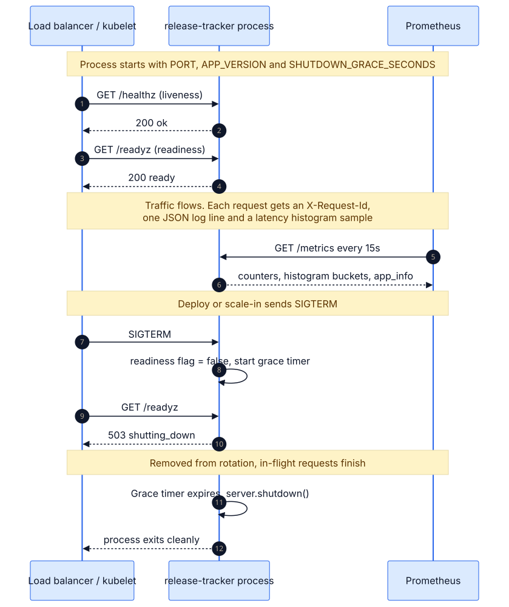

# 01 · Secure CI/CD pipeline for a containerised service

A small HTTP service (`release-tracker`) taken through a pipeline that lints, tests, builds, scans,
generates an SBOM, publishes to GHCR, signs the image and attests its provenance. The point is not the
app; it is a delivery path where every step is automated and a bad change cannot reach `main`
unnoticed.



<sub>Source: [`01a-cicd-pipeline.mmd`](docs/schematics/01a-cicd-pipeline.mmd) · [all schematics](docs/schematics/README.md)</sub>




<sub>Source: [`01b-container-lifecycle.mmd`](docs/schematics/01b-container-lifecycle.mmd) · [all schematics](docs/schematics/README.md)</sub>


## What it demonstrates
- **Pipeline as code** (`.github/workflows/01-secure-cicd.yml`): least-privilege `permissions` per job,
  concurrency control, timeouts, build cache, jobs gated by `needs`.
- **Shift-left security:** secret scanning, image vulnerability scanning with SARIF upload to the
  Security tab, SBOM (SPDX), keyless signing with Sigstore, SLSA-style provenance.
- **Hardened container:** non-root fixed UID, no shell login, healthcheck, and a design that needs no
  writable filesystem (no bytecode, no temp files) so it is meant to run with a read-only root and
  `--cap-drop ALL` (the `make run` target does exactly that; not yet exercised in a container build).
- **Operable service:** liveness/readiness endpoints, Prometheus metrics, structured JSON logs with
  request IDs, graceful shutdown (readiness flips to 503 on SIGTERM so load balancers drain first).
- **Supply-chain hygiene:** Dependabot for Actions and Docker.

## Run it locally
```bash
cd app && python3 -m unittest discover -s tests -v     # 15 tests
cd .. && make build run                                 # needs Docker
curl -s localhost:8080/healthz
curl -s -XPOST localhost:8080/api/deployments \
  -d '{"service":"billing","version":"1.4.2","environment":"prod"}'
curl -s localhost:8080/metrics | head
```
API: `GET /healthz`, `GET /readyz`, `GET /metrics`, `GET|POST /api/deployments`.
`ENABLE_CHAOS=true` adds `/api/simulate?status=500&delay_ms=300` for failure drills (used in project 04).

## Design decisions
| Decision | Why |
|---|---|
| Standard library only | No dependency CVEs to chase; the image has one file of app code. A real service would use a framework: the pipeline is identical. |
| Scan fails the build on HIGH/CRITICAL with fix available (`ignore-unfixed`) | Blocks actionable risk without making the pipeline unusable over unfixable base-image findings. |
| Sign and attest by **digest**, not tag | Tags are mutable; a digest identifies exactly what was built. |
| `workflow_run`-free, single workflow | Easier to read and review than chained workflows. |
| Actions pinned to major versions | Readable now; the next hardening step is pinning to commit SHAs (Dependabot keeps them current). |

## Verification status
| Check | Status |
|---|---|
| 15 unit tests, ruff lint | Run in the build environment: pass |
| Live process test: health, create/list, metrics, fault injection, SIGTERM graceful shutdown | Run: pass |
| hadolint, actionlint on the workflow | Run: clean |
| `docker build`, container smoke test, Trivy, SBOM, GHCR push, cosign | **Not run yet.** No Docker daemon in the build environment; these run in GitHub Actions on the first push. |

## Next improvements
Pin base image by digest and actions by SHA; add an integration test job that runs against the built
container; add release tagging (semver) and a changelog; publish a Helm chart or Kustomize base from the
same pipeline (see project 03).
