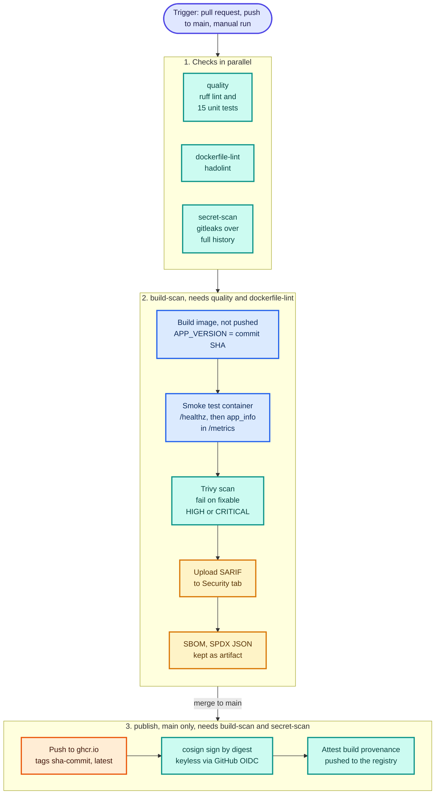
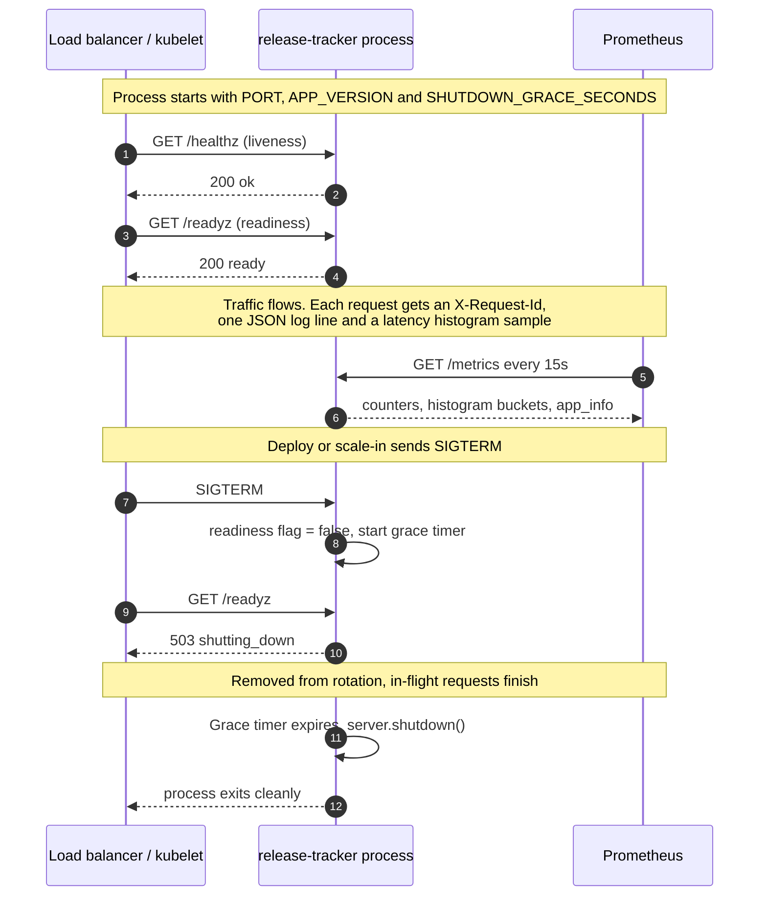

# Schematics: 01-secure-cicd-pipeline

Diagrams are Mermaid, so GitHub renders them inline below. Each also has a rendered `.svg` next to its
`.mmd` source. Edit the `.mmd` file, then run `python3 scripts/build_schematics.py` from the repository root.

## CI/CD pipeline stages

.github/workflows/01-secure-cicd.yml. Three checks run in parallel; build-scan builds the image without pushing, smoke-tests it, fails on fixable HIGH or CRITICAL vulnerabilities and keeps an SBOM; the publish job runs only on main, pushes by digest, signs keylessly with cosign and attaches a provenance attestation.

[SVG](01a-cicd-pipeline.svg) · [source](01a-cicd-pipeline.mmd)

## Container lifecycle

app/server.py. Liveness and readiness probes, Prometheus scraping, and the graceful-shutdown sequence: SIGTERM turns readiness off, the load balancer removes the instance, in-flight requests finish, then the process exits after the grace period.

[SVG](01b-container-lifecycle.svg) · [source](01b-container-lifecycle.mmd)
