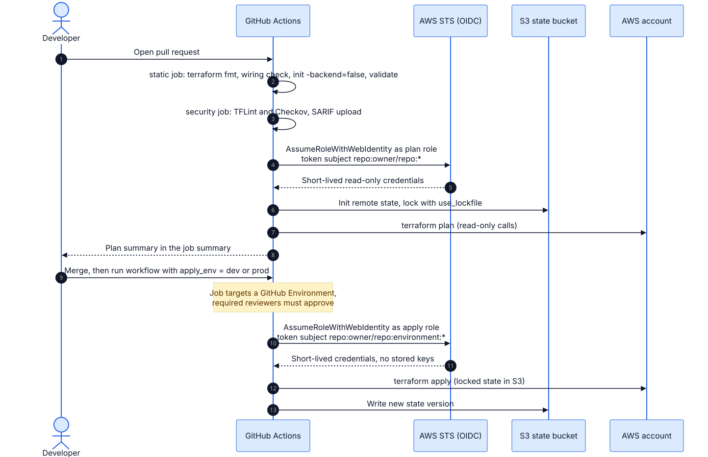

# 02 · AWS platform with Terraform

Infrastructure as code for running the container from project 01 on AWS: a multi-AZ VPC, ECS Fargate
behind an Application Load Balancer, autoscaling, alarms, and a pipeline that plans on pull requests and
applies only through a protected environment, authenticated with short-lived OIDC credentials.



<sub>Source: [`02a-aws-architecture.mmd`](docs/schematics/02a-aws-architecture.mmd) · [all schematics](docs/schematics/README.md)</sub>




<sub>Source: [`02b-terraform-delivery.mmd`](docs/schematics/02b-terraform-delivery.mmd) · [all schematics](docs/schematics/README.md)</sub>


## Layout
```
bootstrap/        one-time: encrypted, versioned S3 state bucket + GitHub OIDC roles
modules/network/  VPC, public/private subnets across 2-3 AZs, NAT (shared or per-AZ), flow logs
modules/ecs-service/  cluster, task def, ALB, security groups, autoscaling, alarms, IAM
envs/dev/         cheap: 1 task, shared NAT, HTTP allowed
envs/prod/        resilient: 3 AZs, NAT per AZ, HTTPS-only (ACM cert required), deletion protection
scripts/check_wiring.py   static module-wiring checker that needs no provider download
```

## What it demonstrates
- **Reusable modules with validated inputs** (CIDR must be /16, image can't be `:latest`, AZ count 2-3).
- **Environment parity with deliberate differences** in `envs/` rather than copy-pasted modules.
- **Secure defaults:** tasks in private subnets with no public IPs; task security group accepts only the
  ALB; ALB drops invalid headers; default security group locked down; TLS 1.3 policy; flow logs;
  state bucket versioned, encrypted, public-access-blocked, TLS-only; non-root, read-only-rootfs container.
- **Safe delivery:** circuit-breaker rollback on failed deployments, autoscaling that owns the replica
  count (`ignore_changes`), separate task *execution* and *task* roles (task role starts empty).
- **Keyless CI auth:** GitHub OIDC; the plan role is read-only, the apply role can only be assumed by
  jobs that target a protected GitHub Environment. The apply policy has no default on purpose.
- **Native S3 state locking** (`use_lockfile`, generally available from Terraform 1.11), so no DynamoDB table to run.

## Use it
```bash
# 1. state bucket + OIDC roles (once, with admin credentials)
cd bootstrap
terraform init && terraform apply -var state_bucket_name=<unique> -var github_repository=<you>/<repo> \
  -var 'apply_policy_arns=["arn:aws:iam::<account>:policy/<scoped-policy>"]'

# 2. an environment
cd ../envs/dev
cp backend.hcl.example backend.hcl && cp terraform.tfvars.example terraform.tfvars   # edit both
terraform init -backend-config=backend.hcl
terraform plan && terraform apply
curl "$(terraform output -raw url)/healthz"
# tear down: terraform destroy   (dev only; prod has deletion protection)
```
Cost note: the NAT gateway and ALB bill hourly even when idle. Use `dev` for experiments and destroy it
afterwards. Check current AWS pricing before leaving anything running.

## Verification status
| Check | Status |
|---|---|
| `fmt -check` (parses all HCL) | Run: pass. CI runs `terraform fmt -recursive -check -diff` on every change and it passes; an earlier local run used OpenTofu 1.10.6 on the same HCL. |
| `scripts/check_wiring.py` (arguments match module variables, required vars supplied, outputs exist) | Run: pass; also proven to catch 4 injected mistakes |
| GitHub Actions on the pull request: `terraform fmt`, wiring check, `terraform init` (no backend) + `validate` for `bootstrap`, `envs/dev` and `envs/prod`; TFLint; Checkov | **Passed on GitHub with OpenTofu 1.10.6. The workflow now uses Terraform 1.13.0 and `required_version` is `>= 1.11.0`; that run is pending.** Validation checks syntax and provider schemas, not real AWS behaviour. Checkov's first 21 findings were triaged: each is skipped inline (`#checkov:skip=ID:reason`) with a written reason, and the scan stays report-only (`soft_fail`) until you decide to make it gate merges. |
| `terraform plan` / `apply` | **Not run.** They are skipped in CI until AWS role and region variables are configured; run `plan` yourself before relying on this. |
| Applied to a real AWS account | **No.** Nothing here has been deployed. Treat the first `plan` as the real test and expect to fix small provider-schema details. |

The AWS provider is pinned to `~> 5.80` here on purpose. A Dependabot bump to 6.70 failed this project's CI checks,
so moving to 6.x is a planned migration. Project 05 already runs on 6.x and passes its own checks.

### Checkov triage
The first scan reported 21 findings. None were hidden: every skip sits next to its resource with the reason.
Accepted as cost/scope trade-offs for a portfolio account: S3 access logging, replication and KMS on the state bucket
(SSE-S3, versioning and public-access-block are on), KMS on log groups and the SNS topic (CloudWatch alarms cannot
publish to an AWS-managed-key topic), per-environment log retention, ALB access logs and WAF, and ALB deletion
protection (a variable: on in prod, off in dev). Those that are real hardening work are listed below.

## Next improvements
Remote module versioning, per-environment IAM boundary for the apply role, WAF on the ALB, Secrets
Manager integration for the task, a Route 53 + ACM module, cost estimation (Infracost) in PRs, and
`terraform test` for the modules.
