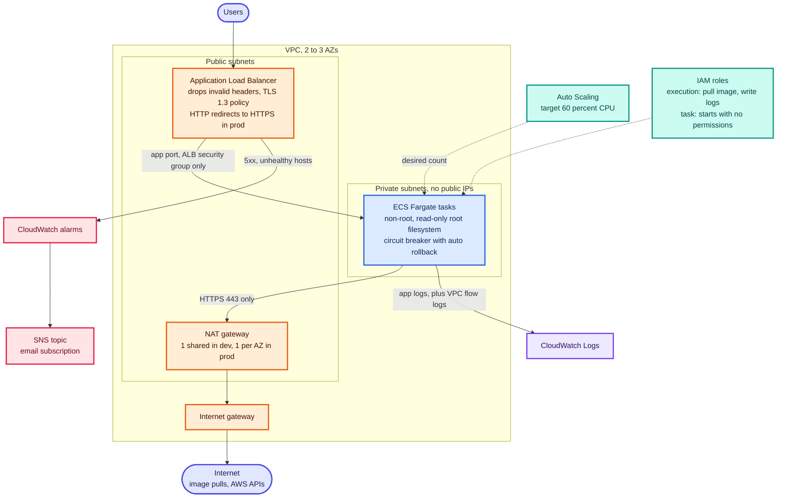
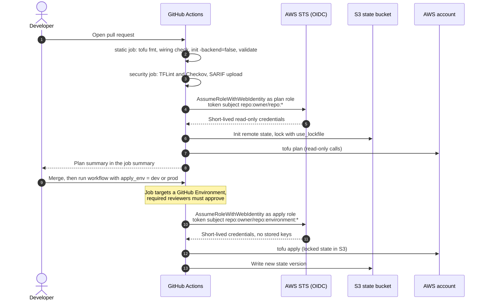

# Schematics: 02-aws-terraform-platform

Diagrams are Mermaid, so GitHub renders them inline below. Each also has a rendered `.svg` next to its
`.mmd` source. Edit the `.mmd` file, then run `python3 scripts/build_schematics.py` from the repository root.

## AWS architecture

modules/network and modules/ecs-service. dev uses two AZs and one shared NAT gateway with HTTP allowed; prod uses three AZs, a NAT gateway per AZ, HTTPS only and deletion protection. Task security groups accept traffic from the ALB only, and the task role starts with no permissions.

[SVG](02a-aws-architecture.svg) · [source](02a-aws-architecture.mmd)

## Terraform delivery with OIDC

.github/workflows/02-terraform.yml and bootstrap/github-oidc.tf. Pull requests are validated and planned with a read-only role. Applying is a manual run that targets a protected GitHub Environment; the apply role's trust policy only accepts tokens for environment jobs, and state is locked in S3.

[SVG](02b-terraform-delivery.svg) · [source](02b-terraform-delivery.mmd)
