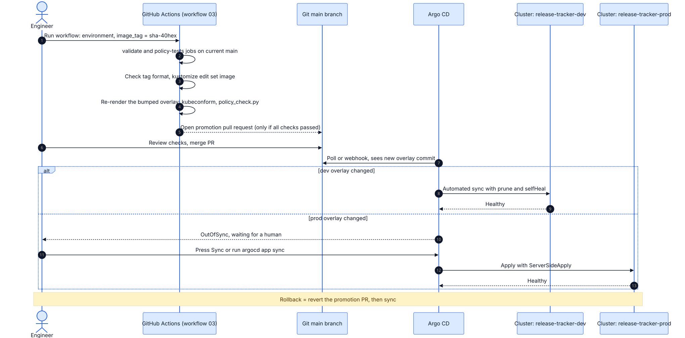

# 03 · Kubernetes delivery with Kustomize and Argo CD (GitOps)

The same service deployed to Kubernetes with production-grade defaults. Git is the source of truth:
promoting a release is a pull request that bumps an image tag, and Argo CD reconciles the cluster to
what is merged.



<sub>Source: [`03a-gitops-promotion.mmd`](docs/schematics/03a-gitops-promotion.mmd) · [all schematics](docs/schematics/README.md)</sub>




<sub>Source: [`03b-manifest-guardrails.mmd`](docs/schematics/03b-manifest-guardrails.mmd) · [all schematics](docs/schematics/README.md)</sub>


## Layout
```
k8s/base/             Deployment, Service, HPA, PDB, NetworkPolicies, Ingress, ServiceAccount
k8s/overlays/dev|prod namespace (Pod Security "restricted"), replicas, resources, host, image tag
argocd/               AppProject (scoped repo/destinations), dev app (auto-sync), prod app (manual)
scripts/policy_check.py  executable guardrails; scripts/test_policy_check.py proves they reject bad input
```

## What it demonstrates
- **Pod hardening:** non-root, read-only root filesystem, no privilege escalation, all capabilities
  dropped, `RuntimeDefault` seccomp, no service-account token, namespace enforcing Pod Security `restricted`.
- **Resilience:** zero-unavailable rolling updates, startup/liveness/readiness probes, HPA, PDB
  (`minAvailable: 2` in prod), zone topology spread (hard in prod).
- **Network least privilege:** default-deny ingress and egress, then only ingress-nginx and monitoring
  may reach port 8080.
- **GitOps controls:** AppProject limits repos, namespaces and cluster-scoped kinds; dev auto-syncs and
  self-heals; prod requires an explicit sync after a reviewed merge; HPA-owned replicas are ignored in diffs.
- **Policy as code with tests:** `policy_check.py` enforces the rules above on the *rendered* manifests,
  and 13 tests prove it fails on root users, writable filesystems, `:latest`, missing limits/probes/HPA/PDB,
  weak Pod Security labels, host networking and a missing default-deny.

## Use it
```bash
# render and check locally (needs kustomize)
kustomize build k8s/overlays/prod | python3 scripts/policy_check.py
python3 -m unittest scripts/test_policy_check.py

# on a cluster with Argo CD and ingress-nginx installed
kubectl apply -f argocd/project.yaml -f argocd/application-dev.yaml -f argocd/application-prod.yaml
```
Image names and repository URLs already point at `Joxejaime/devops-portfolio`; change them if you fork this.

## Verification status
| Check | Status |
|---|---|
| `kustomize build` for dev and prod (9 resources each) | Run: pass |
| Policy checks on both rendered overlays | Run: pass |
| 13 policy tests, including rejection cases | Run: pass |
| GitHub Actions on the pull request: `kustomize build`, strict kubeconform schema validation (core resources and Argo CD CRDs), policy checks for dev and prod, policy-checker tests | **Run on GitHub: pass.** |
| Automated image-tag promotion PR (`promote` job) | **Not run yet.** It only runs on `main` after project 01 publishes an image. |
| Applied to a real cluster / Argo CD sync | **No.** Try it on kind or minikube and record what you see. |

## Next improvements
Sealed Secrets or External Secrets for config; Argo CD ApplicationSet to generate environments; Argo
Rollouts for canary/blue-green; Kyverno or Gatekeeper to enforce the same policy in-cluster; ServiceMonitor
for the Prometheus Operator (the pod annotations assume annotation-based discovery).
