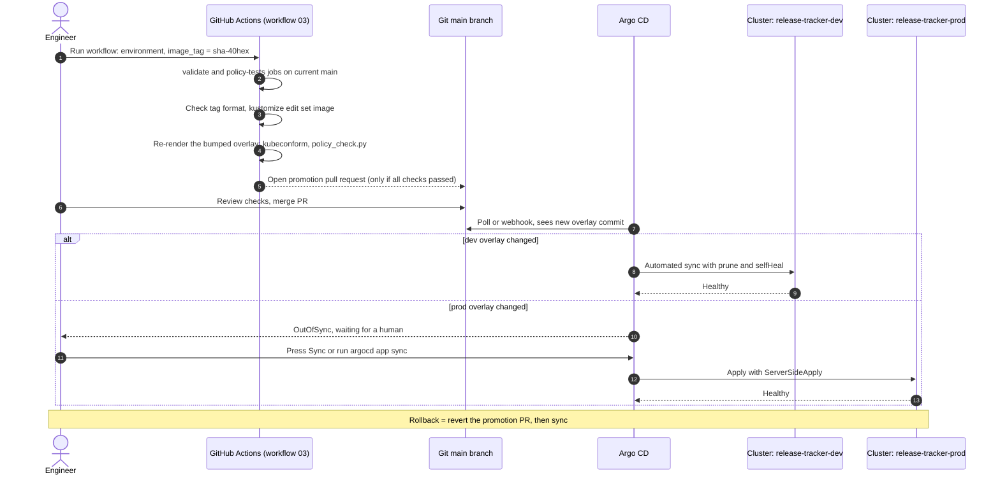
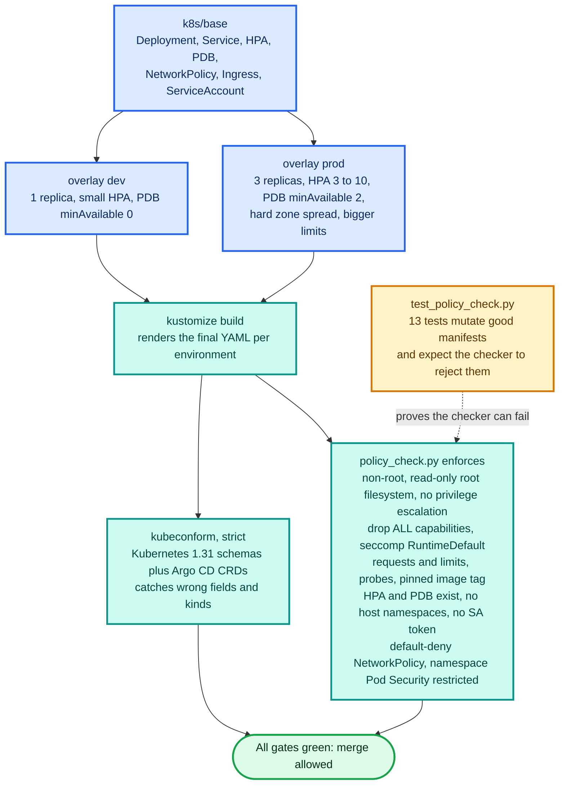

# Schematics: 03-k8s-gitops

Diagrams are Mermaid, so GitHub renders them inline below. Each also has a rendered `.svg` next to its
`.mmd` source. Edit the `.mmd` file, then run `python3 scripts/build_schematics.py` from the repository root.

## GitOps promotion

.github/workflows/03-k8s-gitops.yml and argocd/. The promote job checks the tag format, bumps the overlay, re-renders and policy-checks the promoted manifests, then opens a pull request. Argo CD auto-syncs dev with prune and self-heal; prod has no automated sync and needs an explicit one.

[SVG](03a-gitops-promotion.svg) · [source](03a-gitops-promotion.mmd)

## Manifest guardrails

scripts/policy_check.py and scripts/test_policy_check.py. Overlays are rendered with kustomize, then checked against Kubernetes schemas and a policy script. 13 tests mutate known-good manifests and require the checker to reject them, so the policy is proven able to fail.

[SVG](03b-manifest-guardrails.svg) · [source](03b-manifest-guardrails.mmd)
