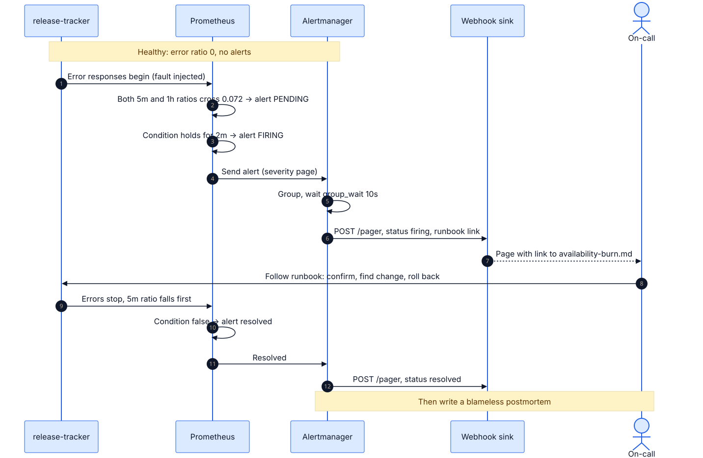

# 04 · Observability and SLO-based alerting

Metrics, dashboards and alerting for the service, built around two service level objectives and
**multi-window, multi-burn-rate alerts**. The alert rules are generated from a single definition and
covered by unit tests that replay synthetic traffic.



<sub>Source: [`04a-observability-stack.mmd`](docs/schematics/04a-observability-stack.mmd) · [all schematics](docs/schematics/README.md)</sub>




<sub>Source: [`04b-burn-rate-logic.mmd`](docs/schematics/04b-burn-rate-logic.mmd) · [all schematics](docs/schematics/README.md)</sub>




<sub>Source: [`04c-alert-lifecycle.mmd`](docs/schematics/04c-alert-lifecycle.mmd) · [all schematics](docs/schematics/README.md)</sub>


## What it demonstrates
- **SLIs/SLOs and error budgets** with a written policy (`docs/slo.md`): 99.5% availability and 95% of
  requests under 250 ms.
- **Burn-rate alerting** (14.4x / 6x page, 3x / 1x ticket) that is fast on real outages and quiet on
  blips (`prometheus/rules/`, generated by `prometheus/gen_slo_rules.py`).
- **Alert rules tested like code:** `promtool test rules` replays total outage, a 10x burn, healthy
  traffic, within-budget errors, excluded health traffic, slow responses, down targets and crash loops.
  Writing these tests found a real bug (the error ratio vanished before the first 5xx), now fixed.
- **Alert routing:** pages vs tickets, grouping, and inhibition so a page suppresses duplicate tickets.
- **Runbooks linked from every alert**, a postmortem template, and a game-day guide to produce your own evidence.
- **Dashboard as code** (`grafana/build_dashboard.py`) with a staleness check, provisioned automatically.

## Run it
```bash
make up                  # app + Prometheus + Alertmanager + Grafana + webhook sink + load
make outage              # inject 50% errors  -> watch AvailabilityFastBurn fire
make healthy             # recover            -> alert resolves
make check test-rules    # offline checks (needs promtool and amtool)
```
Grafana: http://127.0.0.1:3000 · Prometheus: http://127.0.0.1:9090 · Alertmanager: http://127.0.0.1:9093.
Full walkthrough: [`docs/game-day.md`](docs/game-day.md).

## Verification status
| Check | Status |
|---|---|
| `promtool check config` and `check rules`, `amtool check-config` | Run: pass |
| 8 `promtool test rules` scenarios | Run: pass |
| Generated rules and dashboard JSON in sync with their generators | Run: pass |
| `docker compose config` | Run: pass (also in GitHub Actions) |
| GitHub Actions on the pull request: generated files up to date, `promtool` config/rules checks, rule unit tests, `amtool`, compose validation | **Run on GitHub: pass.** |
| **End-to-end:** real Prometheus and Alertmanager binaries scraping the real app with injected 500s, alert fired and delivered to a webhook | Run once in the build environment, see `docs/evidence/e2e-run.md` |
| The Docker Compose stack itself and the Grafana dashboard rendering | **Not run.** No Docker daemon in the build environment. The first `make up` is the real test; the dashboard JSON has never been rendered by Grafana. |

## Next improvements
Long-term storage for a true 30-day budget panel; an external synthetic probe; tracing (OpenTelemetry);
Slack/PagerDuty receivers using file-based secrets; per-route SLOs; log aggregation (Loki).
