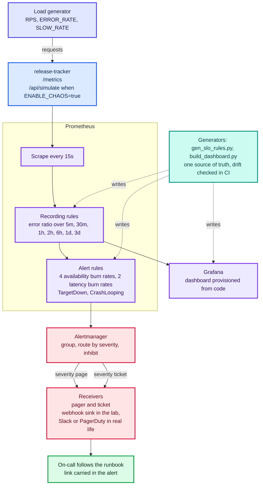
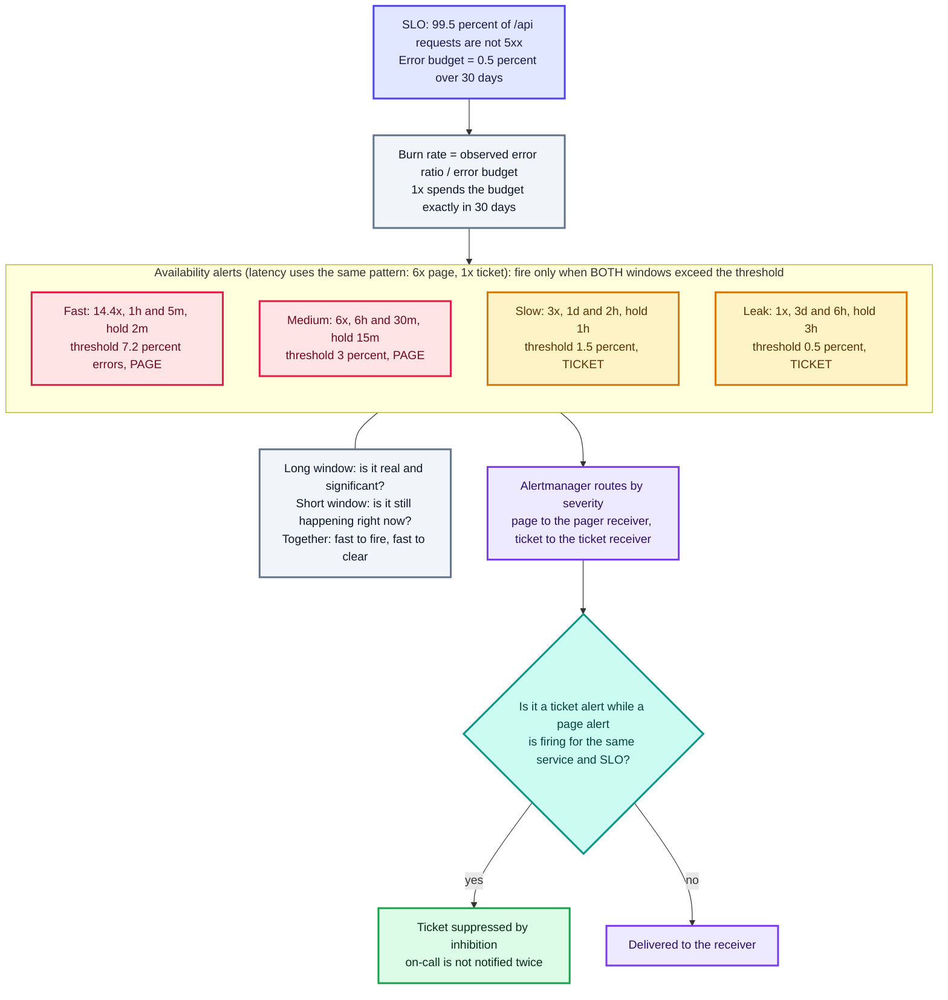
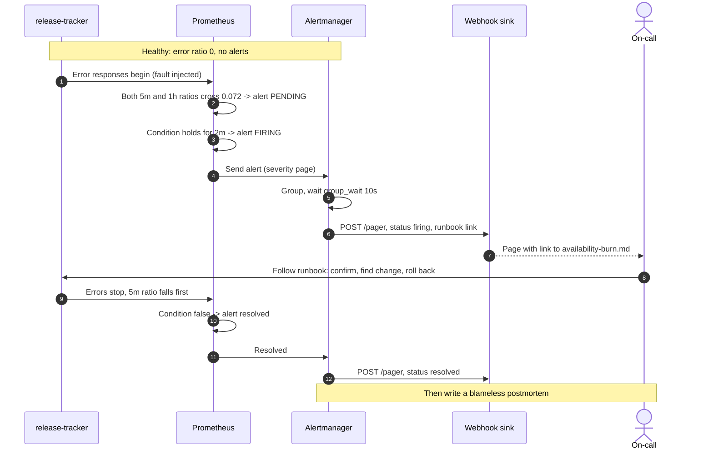

# Schematics: 04-observability-slo

Diagrams are Mermaid, so GitHub renders them inline below. Each also has a rendered `.svg` next to its
`.mmd` source. Edit the `.mmd` file, then run `python3 scripts/build_schematics.py` from the repository root.

## Observability stack

docker-compose.yml, prometheus/gen_slo_rules.py and grafana/build_dashboard.py. A load generator with error and latency knobs drives the service; Prometheus records error ratios and evaluates burn-rate alerts; Alertmanager routes by severity to a webhook receiver; the runbook link travels with the alert.

[SVG](04a-observability-stack.svg) · [source](04a-observability-stack.mmd)

## Burn-rate alert logic

docs/slo.md and prometheus/gen_slo_rules.py. Burn rate is the observed error ratio divided by the error budget. Thresholds are burn rate times budget, the long window proves significance, the short window proves it is still happening, and Alertmanager inhibits ticket alerts while a page alert is firing.

[SVG](04b-burn-rate-logic.svg) · [source](04b-burn-rate-logic.mmd)

## Alert lifecycle

docs/evidence/e2e-run.md. A fault is injected, the alert goes pending then firing after its hold time, Alertmanager delivers a page with a runbook link, and a resolved notification follows when the errors stop.

[SVG](04c-alert-lifecycle.svg) · [source](04c-alert-lifecycle.mmd)
