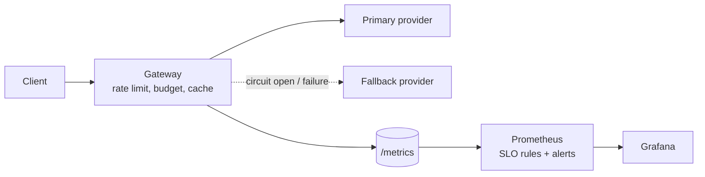

# AI Reliability Platform

A resilient **LLM gateway** built as an end-to-end engineering lifecycle exercise: the application,
the infrastructure it runs on, the delivery pipeline, observability with SLO-based alerting,
incident runbooks, and a failure drill with recorded results.

The point is not the chat endpoint (the providers are mocks). The point is everything that makes an
AI-backed service *operable*: it keeps answering when a provider fails, it protects itself and its
budget from noisy tenants, and it tells you honestly how it is doing.



> **Schematics:** [all diagrams for this project](docs/schematics/README.md) (architecture, request decision flow, circuit breaker, AWS deployment, delivery pipeline).

## What it demonstrates

| Area | Where |
|---|---|
| Resilience patterns: retries with full jitter and deadlines, circuit breaker with half-open probe, fallback, graceful degradation | `gateway/resilience.py`, `gateway/router.py` |
| Cost and abuse protection: per-tenant rate limits and token budgets, bounded memory | `gateway/limits.py` |
| Observability: Prometheus metrics, JSON logs, request IDs, Grafana dashboard | `gateway/metrics.py`, `observability/` |
| SLOs and multi-window burn-rate alerting (Google SRE Workbook style) | `observability/rules/slo.yml`, `docs/slo.md` |
| Testing failure paths deterministically (fake clocks, scripted providers) plus real-server E2E tests | `tests/` |
| Containers and Kubernetes hardening: non-root, read-only FS, probes, HPA, PDB, NetworkPolicy | `Dockerfile`, `k8s/` |
| Infrastructure as code on AWS: ECS Fargate, ALB, private subnets, autoscaling, CloudWatch alarms | `terraform/` |
| CI/CD: lint, tests, config validation, image + IaC scanning, provenance and SBOM on release | `.github/workflows/ai-reliability-platform.yml` (repository root) |
| Incident response: runbooks, postmortem template, failure drill with measured results | `docs/runbooks/`, `docs/incident-drill-report.md` |

## Quick start

Requires Python 3.11+ (no third-party packages) and, for the full stack, Docker.

```bash
make test        # 40 tests, about 1 second
make run         # gateway on :8080 with admin routes enabled (lab token)

curl -s localhost:8080/v1/chat -H 'X-Tenant: demo' -H 'Content-Type: application/json' \
     -d '{"prompt": "Summarise our incident process", "max_tokens": 64}'

make up          # gateway + Prometheus (:9090) + Grafana (:3000, admin/admin)
make drill       # inject a primary outage, watch the circuit open and traffic fail over
```

### Break it on purpose
```bash
curl -s -X POST localhost:8080/admin/faults -H 'X-Admin-Token: lab-only-token' \
     -H 'Content-Type: application/json' -d '{"provider": "primary", "error_rate": 1.0}'
curl -s localhost:8080/admin/state -H 'X-Admin-Token: lab-only-token'   # circuit goes "open"
```

## Evidence

[`docs/incident-drill-report.md`](docs/incident-drill-report.md): in a simulated total outage of the primary
provider, all 180 requests still succeeded through the fallback (p50 about 290 ms vs about 140 ms healthy), the
circuit opened, and it closed again automatically after recovery. It is a local, single-run
demonstration of behaviour, not a capacity benchmark.

## What has and has not been verified

| Verified (run in the build environment) | Not verified (written carefully, needs a run) |
|---|---|
| All 40 unit and end-to-end tests pass | Terraform: not run through `terraform validate`/`apply` (CI does `fmt` + `validate`) |
| Live gateway driven through the incident drill | Docker image build and `docker compose up` (no Docker daemon was available in the build environment) |
| Rule files, dashboard JSON and k8s hardening checks (`scripts/validate_configs.py`) | Prometheus rule evaluation and Grafana rendering with real data |
| `docker compose config` parses the compose file | Kubernetes manifests applied to a cluster |

## Limitations and next steps
Single-process state (rate limits and cache are per instance), no authentication in front of `X-Tenant`,
mock providers only, and one failure mode drilled. See [`docs/architecture.md`](docs/architecture.md) and
[`docs/security.md`](docs/security.md) for the full trade-off and gap lists.

## Repository layout
```
gateway/          application (stdlib only)        tests/         unit + e2e tests
observability/    Prometheus rules, Grafana        k8s/           Kubernetes manifests
terraform/        AWS ECS Fargate                  docs/          architecture, SLOs, runbooks, drill report
loadtest/         load generator                   scripts/       incident drill, config validation
```

## License
MIT
