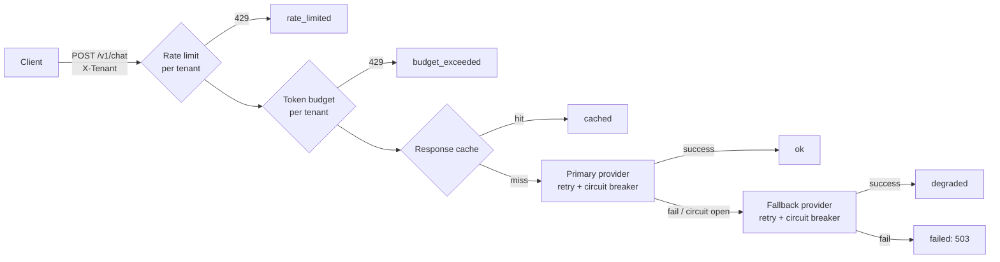

# Architecture

## Request path

Every request ends in exactly one `outcome`, which is the label on `gateway_requests_total`.
That single metric drives the SLO, the dashboards and the alerts.

## Design decisions

| Decision | Why | Trade-off |
|---|---|---|
| Rate limit before anything else | Protect shared capacity and spend from one noisy tenant | Per-instance buckets: effective limit scales with replica count (a shared store such as Redis would fix this) |
| Token budget per tenant | Runaway LLM spend is an availability and cost risk | Fixed windows allow bursts at window edges; a tenant can overshoot by one request |
| Cache before providers | Cheapest, fastest answer; also shields providers during incidents | Only safe for deterministic/idempotent prompts; keys are hashes of (prompt, max_tokens) |
| Retry with full jitter, bounded by an overall deadline | Absorbs transient errors without synchronized retry storms | Retries multiply upstream load during real outages, hence the circuit breaker |
| Per-attempt circuit breaker, half-open probe | Stops hammering a failing upstream and recovers automatically | Consecutive-failure rule is simple but can trip on low traffic; a rolling error-rate window is the next step |
| Rejected (4xx-like) responses do not trip the breaker | A bad request says nothing about provider health | Needs correct error classification from real providers |
| Fallback responses count as *good* for the availability SLO | Users got an answer; the alert split (`degraded` ratio) still signals lost redundancy | Hides quality differences between providers |
| `/healthz` (liveness) separate from `/readyz` (readiness) | Restarting a pod that is only waiting on upstream would make an outage worse | None significant |
| Graceful shutdown: `/readyz` -> 503 for a grace period, then stop | Load balancers stop routing before the process exits, so deploys drop no requests | Slightly slower rollouts |
| Zero runtime dependencies | Tiny image and supply-chain surface; every behaviour is readable in the repo | Hand-written Prometheus exposition and HTTP server; a production service would use proven libraries |

## Deployment topologies

- **Local lab**: `docker-compose.yml` (gateway, Prometheus, Grafana, optional load generator).
- **Kubernetes**: `k8s/gateway.yaml` (restricted pod security, probes, HPA, PDB, NetworkPolicy).
- **AWS**: `terraform/` (ECS Fargate behind an ALB, private subnets, autoscaling, CloudWatch alarms).

## What is intentionally out of scope
Real provider SDKs and secrets handling, shared state (Redis) for limits and cache, authentication
(the `X-Tenant` header is trusted as given and would sit behind an authenticating proxy), tracing.
