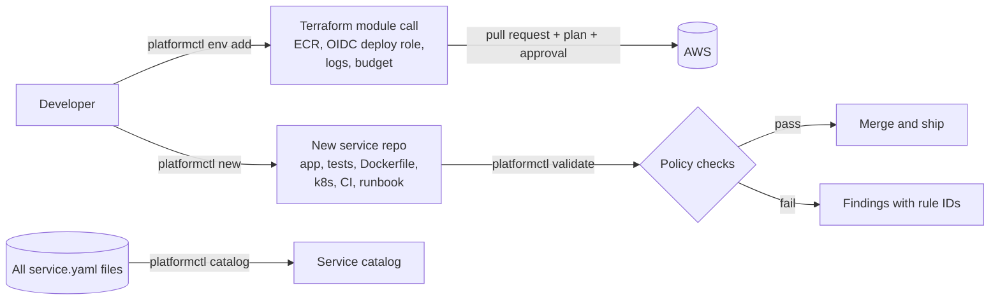

# Self-Service Platform

**`platformctl`**: a small internal-developer-platform toolkit. A developer runs one command and gets a
production-shaped service (code, tests, hardened container, Kubernetes manifests, CI pipeline,
runbook). The platform enforces guardrails as code, keeps a service catalog, and turns cloud
environment requests into reviewable Terraform pull requests.

The idea: **make the secure, reliable path the easiest path**, and make deviations visible.



> **Schematics:** [all diagrams for this project](docs/schematics/README.md) (golden path, policy engine, reliability tiers, Terraform module, service catalog).

## Try it (about a minute, Python 3.11+, needs `pyyaml` and `jinja2`)

```bash
pip install -r requirements.txt

# 1. Golden path: scaffold a critical-tier service
python -m platformctl new billing-api --owner team-billing --tier critical --out /tmp/billing-api

# 2. Guardrails: the generated service passes platform policy out of the box
python -m platformctl validate /tmp/billing-api          # -> 0 error(s), 0 warning(s)

# 3. ...and a non-compliant one does not
python -m platformctl validate examples/non-compliant/legacy-batch      # -> 14 error(s), 3 warning(s)

# 4. Catalog of every service under a directory
python -m platformctl catalog examples

# 5. Self-service infrastructure as a pull request
python -m platformctl env add --service billing-api --env dev \
    --repo Joxejaime/billing-api --owner team-billing --tier critical --out /tmp/infra
```

Real outputs are checked in: [compliant](docs/examples/validate-compliant.txt),
[non-compliant](docs/examples/validate-non-compliant.txt), [catalog](docs/examples/catalog.md).

## What the platform decides for you: reliability tiers

| Tier | Replicas | PDB | Default availability target | CPU req/limit | Memory req/limit |
|---|---|---|---|---|---|
| `critical` | 3 | minAvailable 2 | 99.95% | 250m / 1000m | 256Mi / 512Mi |
| `standard` | 2 | minAvailable 1 | 99.9% | 100m / 500m | 128Mi / 256Mi |
| `best-effort` | 1 | none | 99.0% | 50m / 250m | 64Mi / 128Mi |

Teams state intent (`tier: critical`); the platform expands it into concrete, consistent settings, and
`validate` rejects manifests that drift below the tier's floor.

## Policy rules (`platformctl/policy.py`)

| Area | Rules |
|---|---|
| Spec | required fields, DNS-safe name, `team-*` owner, known tier/envs, SLO range, unknown-field rejection (typo protection) |
| Kubernetes | pinned image (no `latest`) `K8S001`, approved registry `K8S002`, resources `K8S003`, non-root `K8S004`, no privilege escalation `K8S005`, read-only FS (warn) `K8S006`, readiness probe `K8S007`, no privileged/host namespaces `K8S008`, tier replica minimum `K8S009`, ownership labels `K8S010`, liveness (warn) `K8S011` |
| Dockerfile | non-root `USER` `DOCK001`, pinned base image `DOCK002`, `HEALTHCHECK` (warn) `DOCK003` |
| CI | workflow `permissions:` (warn) `CI001`, version-pinned actions `CI002` |
| Catalog | duplicate service names `CAT001` |

Exit codes: `0` clean, `1` policy errors (or warnings with `--strict`), `2` bad usage. Policy values
(registries, labels, replica floors) are overridable with `--policy policies/default.yaml`.

## Infrastructure module

[`terraform/modules/service-environment`](terraform/modules/service-environment) provisions, per service and
environment: an immutable, scan-on-push ECR repository, a log group, **a GitHub OIDC deploy role** (no
stored cloud keys; prod can only be assumed from a protected GitHub *environment*; the role may push only
to its own repository), and an optional tag-scoped cost budget with forecast alerts. `platformctl env add`
writes the module call; see [`infra/services/`](infra/services) for two generated examples.

## Quality

```bash
make test       # 32 tests: scaffold, policy rules (table-driven), CLI exit codes, catalog, env generation
make lint
make demo       # scaffold -> validate -> run the generated service's own tests
```

Notable tests: a freshly scaffolded service must pass policy for **every** tier, the generated service's
own test suite must pass, and each policy rule has a mutation test that breaks one thing and expects
exactly that finding.

## What has and has not been verified

| Verified (run in the build environment) | Not verified |
|---|---|
| All 32 tests, lint, scaffold -> validate -> generated tests round trip; CI also runs `terraform validate` on the module and the generated environments | `terraform apply`: nothing has been provisioned in a real AWS account |
| Example outputs in `docs/examples/` are real tool output | Generated Dockerfile build and Kubernetes manifests not applied to a cluster |
| | Registry defaults to `ghcr.io/joxejaime` and the example repositories are under `Joxejaime/`, so the defaults only fit a personal account. Generated `CODEOWNERS` names `@Joxejaime`, because GitHub team handles (`@org/team`) only exist in an organization; inside one, scaffold with `--code-owner @<org>/<team>` |

## Scope and next steps
Python services only (the template layer is built for adding languages); `validate` is a focused rule set,
not a replacement for OPA/Kyverno/Conftest at scale; no UI portal (a Backstage plugin or a web form could sit on
top of this CLI). See [`docs/design.md`](docs/design.md).

## License
MIT
