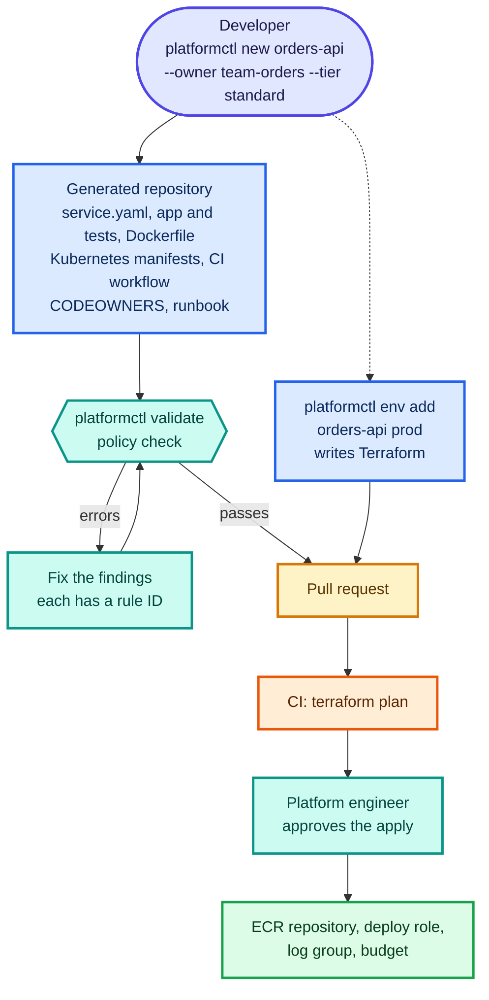
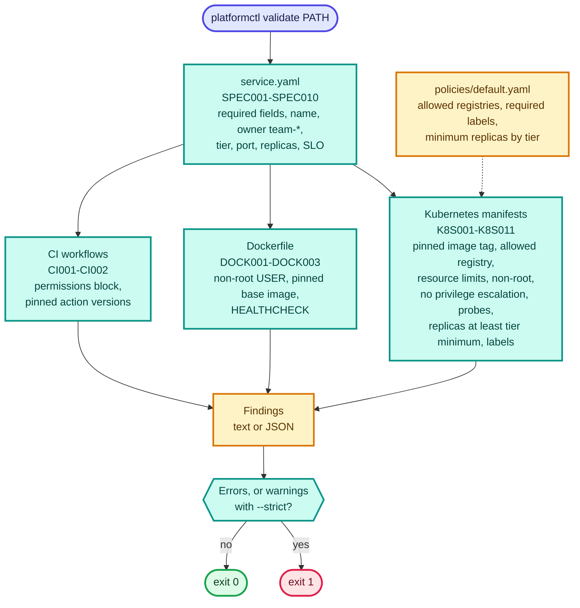
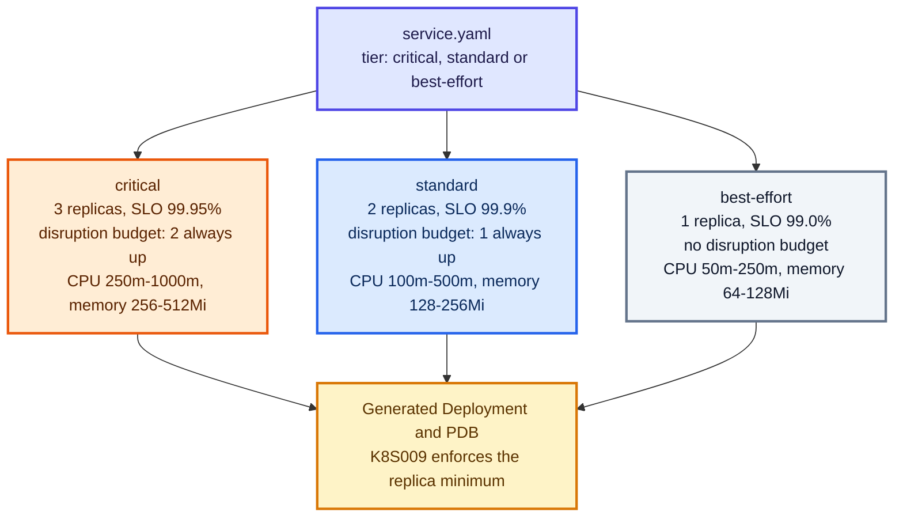
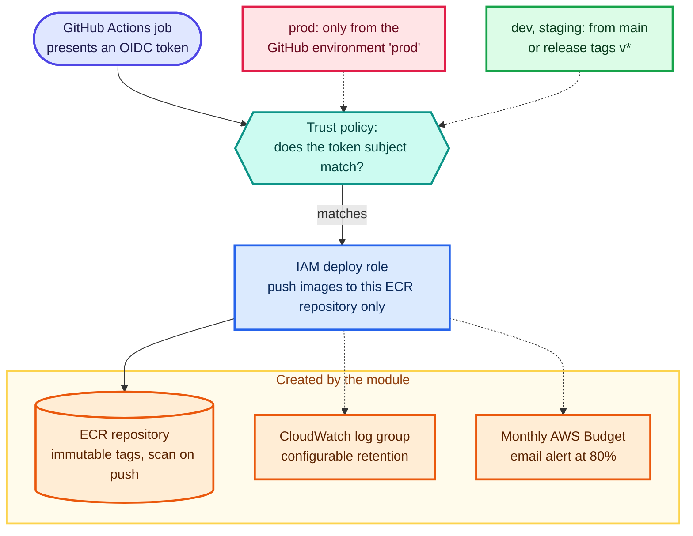
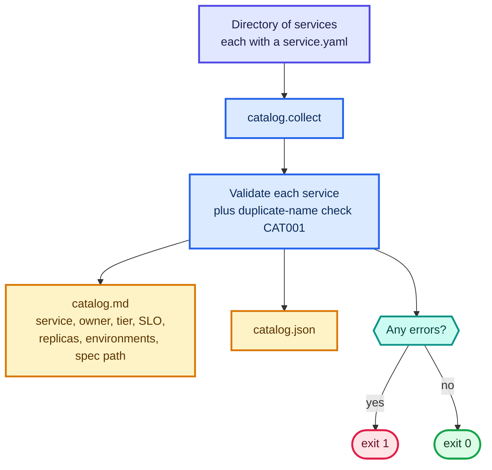

# Schematics: self-service-platform

Diagrams are Mermaid, so GitHub renders them inline below. Each also has a rendered `.svg` next to its
`.mmd` source. Edit the `.mmd` file, then run `python3 scripts/build_schematics.py` from the repository root.

## The golden path

From a developer's request to a running, compliant service. Generating and validating a repository are implemented and tested here. The pull request, terraform plan, approval and apply half is the intended workflow, generated as files but not exercised end to end.

[SVG](01-golden-path.svg) · [source](01-golden-path.mmd)

## Policy-as-code validation

platformctl/policy.py. validate_repo reads service.yaml first (its tier sets the expectations), then checks each file type. Every finding has a stable ID. Errors fail the command (exit 1); warnings fail only with --strict. Policy values default to built-ins and can be overridden with --policy policies/default.yaml; unknown keys are rejected.

[SVG](02-policy-engine.svg) · [source](02-policy-engine.mmd)

## Reliability tiers

A tier is the only reliability choice a developer makes; defaults for replicas, resources, SLO and disruption budget follow from it (platformctl/models.py TIER_DEFAULTS). The K8S009 rule rejects manifests with fewer replicas than the tier minimum.

[SVG](03-reliability-tiers.svg) · [source](03-reliability-tiers.mmd)

## Terraform service-environment module

terraform/modules/service-environment. One module call per service and environment (generated by platformctl env add). The deploy role trusts GitHub's OIDC provider, so there are no long-lived AWS keys; prod can only be assumed from a GitHub environment (which can require reviewers), lower environments from main or release tags. All resources carry service, environment, owner, tier and ManagedBy tags. The budget is created only when alert emails are set. Written and statically reviewed, not applied.

[SVG](04-terraform-module.svg) · [source](04-terraform-module.mmd)

## Service catalog

platformctl/catalog.py. The catalog is built by scanning a directory of service.yaml files and running the same validation on each; a duplicate service name is CAT001. The command exits 1 if any service has an error, so it can gate CI.

[SVG](05-service-catalog.svg) · [source](05-service-catalog.mmd)
