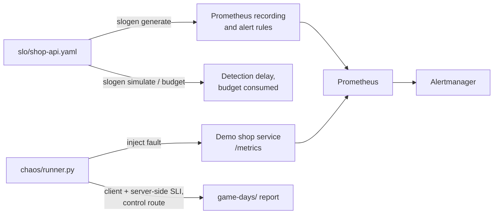

# SRE Reliability Lab

**SLOs as code, burn-rate alerts generated from them, an incident simulator, and chaos experiments that
produce game-day reports.** One SLO file is the source of truth for the Prometheus rules, the alert
thresholds and the error-budget maths, and a small chaos runner checks that the system behaves the way
the SLOs claim.

The service under test (`demo/shop.py`) is deliberately tiny. The point is the reliability practice around it:
define what "good" means, alert on how fast the budget burns, rehearse failures, and write down what you learned.



> **Schematics:** [all diagrams for this project](docs/schematics/README.md) (architecture, SLO to alerts, alert routing, chaos experiment lifecycle, delivery pipeline).

## What it demonstrates

| Area | Where |
|---|---|
| SLOs as code: availability and latency SLIs defined as good/valid ratios, validated on load | `slo/shop-api.yaml`, `slogen/model.py` |
| Multi-window, multi-burn-rate alerting (14.4x / 6x / 3x / 1x, Google SRE Workbook policy) generated, not hand-written | `slogen/policies.py`, `slogen/rules.py`, `generated/shop-api.rules.yml` |
| CI fails if generated rules are stale relative to the SLO file | `make generate-check`, `.github/workflows/07-sre-reliability-lab.yml` (repository root) |
| Incident simulator: replay an incident, see which alert fires, how late, and how much budget was gone | `slogen/simulate.py` |
| Chaos experiments with a steady-state precondition, abort guardrail, control route and server-side SLI cross-check | `chaos/runner.py`, `chaos/scenarios/` |
| Alert routing and inhibition (pages vs tickets) | `observability/alertmanager.yml` |
| Dashboards provisioned as code | `observability/grafana/` |
| Runbooks tied to alerts, a game-day playbook, a postmortem template | `docs/`, `postmortems/` |
| Game-day log with findings and follow-ups | `game-days/` |

## Quick start

Python 3.11+ and PyYAML. Docker is only needed for the full Prometheus/Alertmanager/Grafana stack.

```bash
pip install -r requirements.txt
make test            # 33 tests (about 30 s: they run real chaos experiments)
make generate        # regenerate generated/shop-api.rules.yml from slo/shop-api.yaml
make simulate        # replay a 30-minute, 5% error incident through the alert policies
python3 -m slogen budget --objective 99.9 --window 30d --good 9995000 --total 10000000

make demo            # demo service on :8081 (fault injection enabled, lab token)
make chaos-errors    # in another shell: 30% of /checkout fails for 20 s; writes game-days/checkout-errors.md
make up              # full stack: service, traffic, Prometheus, Alertmanager, Grafana (:3000)
```

### What the simulator says

```
$ make simulate
SLO 99.9% over 30d (error budget 0.1000%); incident: 5.0% errors for 30 min (burn rate 50.0x)

policy       severity  threshold  fires?    after   budget used at alert   clears after end
FastBurn     page        0.01440  yes       18 min                 2.20%              3 min
ModerateBurn page        0.00600  no            -                      -                  -
SlowBurn     ticket      0.00300  no            -                      -                  -
Drift        ticket      0.00100  no            -                      -                  -

Total error budget consumed by the incident: 3.47%
```

A 50x burn pages after 18 minutes, having already spent 2.2% of the monthly budget. The delay comes mostly from the
1-hour long window, which needs the average error ratio to cross 1.44% (5% x 17.3 min / 60 min); that is the price of
not paging on brief blips. See [`docs/slo-methodology.md`](docs/slo-methodology.md).

## Evidence: game days

Two experiments have been run against the demo service ([`game-days/`](game-days/README.md)):

| Experiment | Injected | Client-side | Server-side SLI | Control route | Verdict |
|---|---|---|---|---|---|
| checkout errors | 30% HTTP 500 for 20 s | 30.3% errors | 30.2% bad | 0.0% | hypothesis held |
| checkout latency | +400 ms for 20 s | 0% errors, 99.8% slow, p95 459 ms | 99.8% bad | 0.0% | hypothesis held |

The latency fault produced zero errors, so an availability-only alert would have stayed silent while the latency SLO
burned. The log also records the runner's own flaws that were found and fixed (an untested blast-radius claim,
a "recovery time" that was really the window length) and the follow-ups still open.

## What has and has not been verified

| Verified (run in the build environment) | Not verified (needs a run) |
|---|---|
| All 33 tests pass, including live chaos experiments against the demo service; CI syntax-checks the generated rules with `promtool check rules` | Prometheus *evaluating* those rules against real series: `promtool` proves they parse, not that they fire correctly |
| Generated rules file is reproducible from the SLO file (`--check`) | Alerts **firing** in Alertmanager: the 20 s experiments are far too short; the runner projects alert behaviour with the simulator instead |
| Simulator and budget maths covered by tests and exercised from the CLI | `docker compose up` (no Docker daemon was available); only `docker compose config` was run |
| Config checks: rule file structure, dashboard JSON, compose file | Grafana rendering with real data |

## Limitations and next steps
One service, two fault types, single runs on one machine, and no real traffic mix. Next: a 15-minute run with
Prometheus up to watch a page arrive in Alertmanager, a downstream-dependency timeout scenario, a saturation scenario,
and a real postmortem once there is a real incident (`postmortems/` deliberately contains only a template: it would
be dishonest to invent incidents).

## Repository layout
```
slo/              SLO definitions (source of truth)     slogen/         generator, simulator, CLI
generated/        Prometheus rules (generated)          chaos/          experiment runner + scenarios
demo/             service under test + load generator   observability/  Prometheus, Alertmanager, Grafana
docs/             methodology, playbook, runbooks       game-days/      reports and findings log
postmortems/      template                              tests/          unit + live experiment tests
```

## License
MIT
