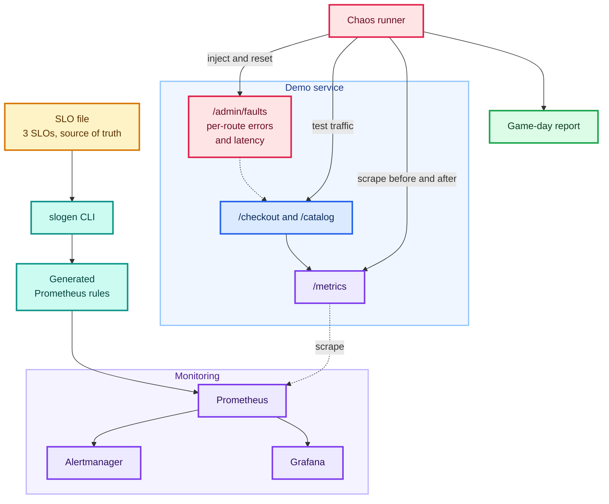
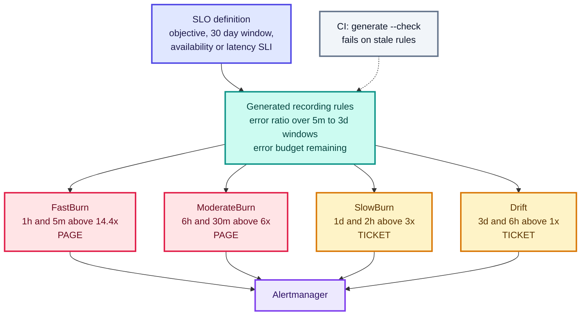
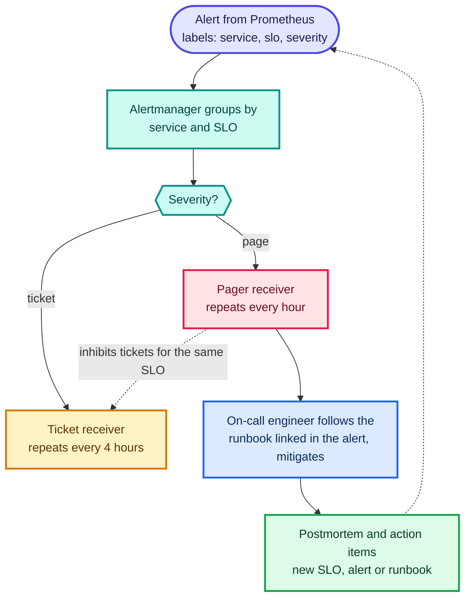
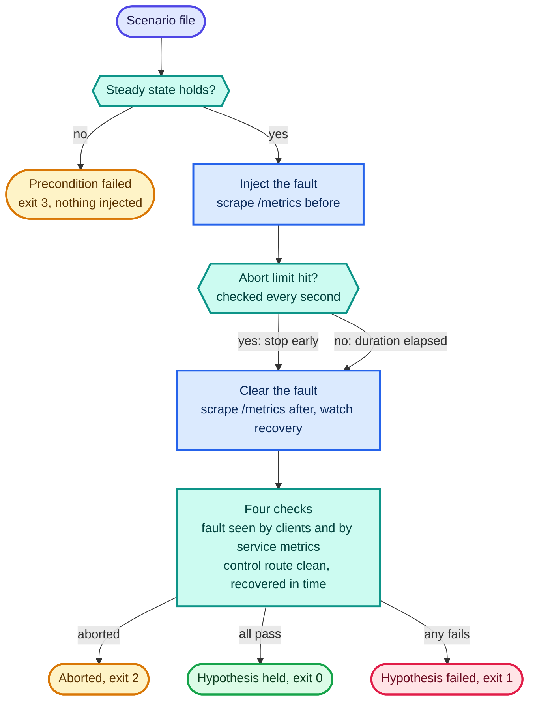
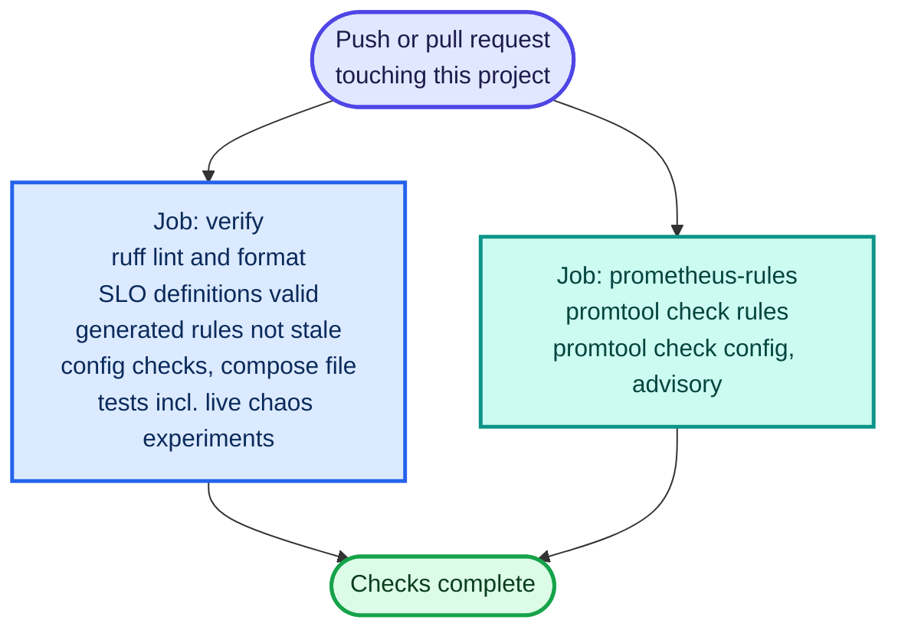

# Schematics: sre-reliability-lab

Diagrams are Mermaid, so GitHub renders them inline below. Each also has a rendered `.svg` next to its
`.mmd` source. Edit the `.mmd` file, then run `python3 scripts/build_schematics.py` from the repository root.

## System architecture

Everything in the lab. The SLO file drives the alert rules; the demo service gives them something real to measure; the chaos runner injects faults into the service and measures the result from the client side and from the service's own /metrics. The compose stack (make up) runs the service, load generator, Prometheus, Alertmanager and Grafana.

[SVG](01-architecture.svg) · [source](01-architecture.mmd)

## From SLO to alerts

slogen/rules.py and slogen/policies.py. An SLO is stated once; the recording rules and the four burn-rate alerts are generated from it, never hand-written. Each alert needs BOTH windows above threshold (burn rate x error budget): the long window proves the burn is significant, the short window proves it is still happening, so the alert clears quickly after a fix. CI runs generate --check, and slogen simulate replays an incident through the same four policies.

[SVG](02-slo-to-alerts.svg) · [source](02-slo-to-alerts.mmd)

## Alert routing and the response loop

observability/alertmanager.yml plus the docs. Pages go to the pager receiver and repeat hourly; everything else goes to the ticket receiver every 4 h. While a page is firing for an SLO, its ticket-level alerts are inhibited. Receiver URLs are placeholders: swap in PagerDuty, Opsgenie or Slack. The postmortems folder holds only a template, because no real incident has happened.

[SVG](03-alert-routing.svg) · [source](03-alert-routing.mmd)

## Chaos experiment lifecycle

chaos/runner.py. The runner refuses to inject unless steady state holds, checks the abort condition every second, always clears the fault, and gives its verdict only after four checks: the fault was visible to clients, it was visible in the service's own metrics, a control route stayed healthy, and the service recovered in time. Exit codes: 0 held, 1 failed, 2 aborted, 3 precondition failed. Traffic threads are always stopped in a finally block.

[SVG](04-chaos-experiment.svg) · [source](04-chaos-experiment.mmd)

## Delivery pipeline (GitHub Actions)

.github/workflows/07-sre-reliability-lab.yml at the repository root. The verify job runs the same checks as make lint, check and test. The promtool job runs Prometheus' own checker on the generated rules, which is the authoritative syntax check that could not be run in the build environment.

[SVG](05-delivery-pipeline.svg) · [source](05-delivery-pipeline.mmd)
