# 08 · Disaster Recovery Autopilot

**When something breaks, recover it, prove the recovery with data checks, and write the postmortem draft.**
`drpilot` takes alerts from the monitoring you already run (project 04), opens an incident, runs the matching recovery
playbook, and only calls the service recovered after consecutive healthy probes **and** passing data checks. When the
incident closes it writes a postmortem draft with the timeline, every step and its output, and whether the declared RTO
and RPO were met. It can open the draft as a GitHub issue for review.

It does not pretend to know why things broke. Root cause, plain-language impact and action-item owners are left as
explicit `TODO (human)` sections, because an automated postmortem that guesses a root cause is confident fiction.



<sub>Source: [`01-architecture.mmd`](docs/schematics/01-architecture.mmd) · [all schematics](docs/schematics/README.md) (architecture, incident lifecycle)</sub>

## How it fits with the other projects

| Project | Responsibility | What 08 reuses from it |
|---|---|---|
| 02 AWS platform | Terraform for the platform | `infra-reapply-dev` re-applies 02's `envs/dev` with its remote state |
| 03 Kubernetes GitOps | Deployments and Argo CD | `k8s-rollback-crashloop` rolls back 03's `release-tracker` Deployment |
| 04 Observability | **Detects and pages** | its Prometheus and Alertmanager: 08 adds rules and one route, and matches 04's own `TargetDown` and `CrashLooping` |
| 07 SRE lab | Controlled failure experiments | the idea: 08's drills break a real database the same way, but verify *recovery* |
| **08 (this)** | **Restore, validate, document** | |

Detection is deliberately not rebuilt here. The drills use a 20-line probe loop that stands in for Prometheus and
Alertmanager; it is not a product feature.

## What it demonstrates

| Area | Where |
|---|---|
| Real database recovery: `pg_dump`/`pg_restore`, snapshots with manifests (checksum, row counts), local directory or S3 | `recovery/`, `demo/orders.py` |
| **A snapshot only counts once it has been restored**: every snapshot is restored into a scratch database and validated when taken, and again before it is trusted | `recovery/snapshots.py` |
| Recovery validation beyond a health check: schema, row counts against the manifest, orphans, order totals against items, and a write through the service | `recovery/validate.py`, `scripts/recover.py validate` |
| Corrupt or poisoned backups are skipped, never restored; if none verifies, automation escalates | `make drill-poisoned`, `make drill-fail` |
| RTO and RPO declared per playbook and checked in every draft; RPO is measured from the snapshot's own timestamp to the start of the impact | `playbooks/`, `drpilot/render.py` |
| Scheduled restore test emits Prometheus metrics; failing or stale tests alert, and a failing one triggers a fresh validated snapshot | `recovery/cli.py`, `observability/alert-rules.yml`, `playbooks/backup-refresh.yaml` |
| Infrastructure and Kubernetes recovery by reusing 02 and 03; prod is deliberately never auto-applied | `playbooks/infra-reapply-dev.yaml`, `playbooks/k8s-rollback-crashloop.yaml` |
| Snapshot bucket as Terraform: versioned, encrypted, private, TLS-only, and a writer policy that cannot delete | `infra/backup-bucket/` |
| Alertmanager webhook receiver: bearer-token auth, body limit, idempotent repeat notifications | `drpilot/server.py` |
| Incident lifecycle: closed only when every alert resolved **and** no recovery is running | `drpilot/engine.py` |
| Playbooks as YAML: most-specific match wins, retries, argv commands with no shell, secrets only from the environment | `drpilot/playbooks.py` |
| Drills against a real PostgreSQL server, with their postmortem drafts committed unedited | `drpilot/drill.py`, `postmortems/drills/` |
| pytest suite with integration tests that skip cleanly where PostgreSQL is not installed | `tests/` |

## Quick start

Python 3.11+. The integration tests and drills also need PostgreSQL 14+ server and client binaries (`initdb`, `pg_ctl`,
`postgres`, `pg_dump`, `pg_restore`); they start their own throwaway server and delete it. No Docker, no cloud account.

```bash
make install        # pyyaml, psycopg, pytest, ruff
make test           # fast tests, no PostgreSQL needed
make test-all       # 85 tests incl. real-PostgreSQL integration and all three drills (about 45 s)
make check          # validate every playbook
make drills         # the three drills; drafts land in postmortems/drills/
make replay         # a sample Alertmanager incident with no playbook: the escalation path
```

### What the drills print

```
$ make drills
scenario dropped-table: incident 20261026-123941-ordersdataunhealthy-38be, recovery succeeded, ...
data: 5 orders restored and intact; 2 written after the snapshot were lost (expected: RPO > 0)
RTO (impact start to service restored): target 5m 00s, observed 1.9s -> met
RPO (last good snapshot to impact start): target 15m 00s, observed 1.5s -> met
DRILL PASSED

scenario poisoned-backup: ... recovery succeeded, ...
data: newest snapshot skipped (order totals did not match items), older one restored: 5 orders, totals intact
DRILL PASSED

scenario corrupt-backups: ... recovery failed, ...
data: automation refused to restore a rotted snapshot and escalated; 7 orders lost, rebuilt by hand
RPO (last good snapshot to impact start): target 15m 00s, observed unknown (no restore reported it) -> MISSED
DRILL PASSED
```

"Passed" for the last two means **the tool did the right thing**: it would not restore wrong or rotted data, and the
draft says exactly why. The drafts are in [`postmortems/drills/`](postmortems/README.md). Timings are from a tiny database
on one machine; they show the mechanism works, not how long *your* restore takes. `recover.py restore-test` measures that.

## Running it for real

```bash
export DRPILOT_TOKEN=$(openssl rand -hex 16)          # Alertmanager sends this as a bearer token
export DATABASE_URL=postgresql://app@db/orders        # the user needs CREATEDB: restores are proven in a scratch database
export BACKUP_STORE=s3://my-backups/orders            # or a directory
export ORDERS_URL=http://orders:8090
python -m drpilot serve --host 0.0.0.0 --port 9095 --state /var/lib/drpilot --postmortems /var/lib/drpilot/postmortems
```

1. **Detection:** merge the snippets in [`observability/`](observability/README.md) into 04's Prometheus and Alertmanager.
   Pages still go to people; alerts labelled `autoremediate="true"` also go to drpilot. `send_resolved: true` is required:
   resolution is what closes the incident.
2. **Backups:** schedule `python scripts/recover.py snapshot` (validates the live data first, refuses to back up wrong
   data) and `restore-test` (see the [runbook](docs/runbooks/backup-restore-test.md)).
3. **Bucket:** [`infra/backup-bucket`](infra/backup-bucket/main.tf) creates the S3 bucket and a writer policy with no
   delete permission.
4. **Drafts as issues:** set `DRPILOT_GITHUB_REPO=owner/name` and `DRPILOT_GITHUB_TOKEN` (fine-grained, Issues: write on
   that repository only). Publishing is best effort; the file on disk is always written.

### Writing a playbook

```yaml
name: orders-restore-from-snapshot
match: {alertname: OrdersDataUnhealthy, service: orders}   # all must equal the alert's labels; most keys wins
max_attempts: 2
objectives: {rto_seconds: 300, rpo_seconds: 900}
steps:
  - name: Restore newest verified snapshot
    run: ["{python}", "{playbook_dir}/../scripts/recover.py", "restore"]
verify:
  url: "{env.ORDERS_URL}/healthz"        # N consecutive healthy probes ...
  successes: 3
  checks:                                # ... then every data check must pass
    - name: Validate recovered data and write path
      run: ["{python}", "{playbook_dir}/../scripts/recover.py", "validate", "--smoke-url", "{env.ORDERS_URL}"]
```

A command that prints `{"facts": {...}}` as its last line has those facts recorded in the draft; `snapshot_created_at`
is what the RPO check reads.

## Design decisions

- **Humans are paged anyway.** Automation runs in parallel with the page, not instead of it.
- **Verified, or it did not happen.** A restore that exits 0 is not a recovery. Health probes prove the service answers;
  data checks prove the data is right. Neither alone is enough.
- **Never restore what does not verify.** Each candidate is checksummed, restored into a scratch database and validated
  against its manifest *before* it touches the live database. Newest first, falling back to older ones.
- **Never back up what is already wrong.** `snapshot` validates the live data first. (`--unverified` exists only to
  simulate a backup job without that check, for the poisoned-backup drill.)
- **Backups cannot be destroyed by the thing writing them.** The writer policy has no `s3:DeleteObject`; versioning keeps
  overwritten objects. The dump is uploaded before the manifest, so a half-uploaded snapshot is invisible.
- **Prod infrastructure is never auto-applied.** `infra-reapply-dev` needs `environment: dev`; a prod alert has no
  playbook and escalates, which a test asserts.
- **No shell, no label injection, no secrets in argv.** Commands are argv lists; `{label.x}` is substituted only for plain
  names; connection details reach `pg_dump`/`pg_restore` as `PG*` environment variables, never as arguments.
- **The postmortem waits for the automation**, so it never misses the end of its own story. Repeat notifications are
  idempotent: Alertmanager re-sends firing alerts and that must not run a second restore.

## What has and has not been verified

| Verified (run in the build environment) | Not verified |
|---|---|
| 85 tests pass: engine, playbooks, renderer, server, publisher, and real-PostgreSQL 16 tests of snapshot, restore, validation, restore-test and the service | **Terraform:** `infra/backup-bucket` has never had `fmt`, `validate` or TFLint run (no Terraform binary here); CI will, and has not yet |
| All three drills run end to end against a real PostgreSQL server; their drafts are committed | **AWS:** nothing was applied or stored; the S3 store is tested only against a stand-in `aws` script that checks the commands drpilot issues, not against S3 |
| Corrupt and poisoned snapshots are skipped; with none left the restore refuses and touches nothing | **`infra-reapply-dev` and `k8s-rollback-crashloop`** run only against stub `terraform`/`kubectl`: argument order, the path into 02/03, and that prod is not matched |
| `drpilot serve` rejects unauthenticated webhooks and answers bad input with 400 (tests) | **Prometheus and Alertmanager:** CI syntax-checks the alert rules with `promtool check rules`; the Alertmanager snippet is checked structurally by merging it into 04's real file, and neither has run in a live Alertmanager |
| Alert rules, playbooks and runbooks agree with each other and with 04's rule files (a test) | **Real incidents:** none exist, so no draft here describes one |

## Limitations and next steps

- One responder with a JSON-file store, one process: a real deployment needs a single leader or a shared store.
- Prometheus's `startsAt` is when an alert began *firing*, after its `for:` wait, so with real alerts "time to detect"
  excludes that wait. The drills date impact from the first failed probe.
- Restores here are logical (`pg_dump`). Large databases need physical backups and point-in-time recovery (WAL
  archiving), which would shrink the RPO from minutes to seconds; that is the next step, not something to bolt on early.
- No cooldown per playbook: a flapping alert could trigger many restores. Alert-to-action rate limiting comes next.
- Multi-region replication is deliberately deferred: backup-and-restore first, because recovery objectives, complexity and
  cost trade off, and this is the cheapest tier that still gets drilled.
- Action items are suggested, not tracked; the closing loop today is the scheduled restore test.

## Repository layout
```
drpilot/          responder, playbooks, renderer, webhook server, drill, throwaway PostgreSQL helper
recovery/         snapshot, restore, validate, restore-test, local and S3 stores   scripts/  recover.py entry point
playbooks/        recovery playbooks (YAML)                demo/           orders service + schema
observability/    rules and snippets to merge into 04       infra/          backup bucket (Terraform)
postmortems/      drills/ holds the committed drill drafts   docs/           runbooks, schematics
examples/         sample Alertmanager payloads               tests/          pytest: unit, integration, drills
```

## License
MIT
