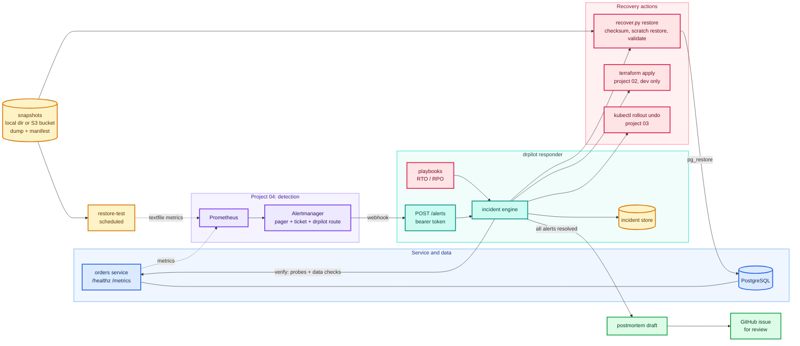

# Schematics: 08-disaster-recovery-autopilot

Diagrams are Mermaid, so GitHub renders them inline below. Each also has a rendered `.svg` next to its
`.mmd` source. Edit the `.mmd` file, then run `python3 scripts/build_schematics.py` from the repository root.

## System architecture

Project 04's Prometheus and Alertmanager detect the failure and route alerts labelled autoremediate to drpilot while still paging people. The responder opens an incident and runs the most specific playbook: restore the newest snapshot that proves itself (checksum, scratch restore and data checks, in that order), or re-apply project 02's Terraform for dev, or roll back project 03's Deployment. Recovery only counts after consecutive healthy probes and passing data checks. A scheduled restore test feeds metrics back to Prometheus, so a backup that stops restoring raises an alert before it is needed. When every alert has resolved the postmortem draft is written, optionally as a GitHub issue.

[SVG](01-architecture.svg) · [source](01-architecture.mmd)

## Incident lifecycle

The states an incident moves through. Repeated notifications for a firing alert do not re-run recovery. An incident closes only when every alert in it has resolved and no recovery is still running, so the postmortem always includes the full automation record. With no matching playbook, or after the last failed attempt, the incident is escalated, and the draft says so and proposes the follow-up.

[SVG](02-incident-lifecycle.svg) · [source](02-incident-lifecycle.mmd)
