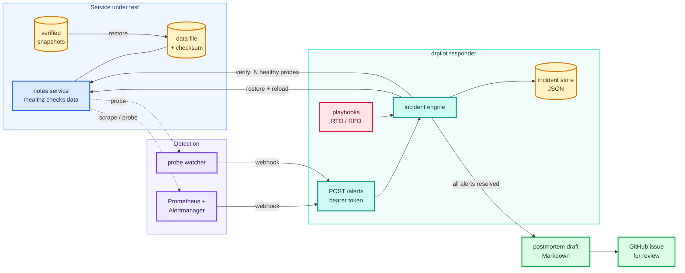
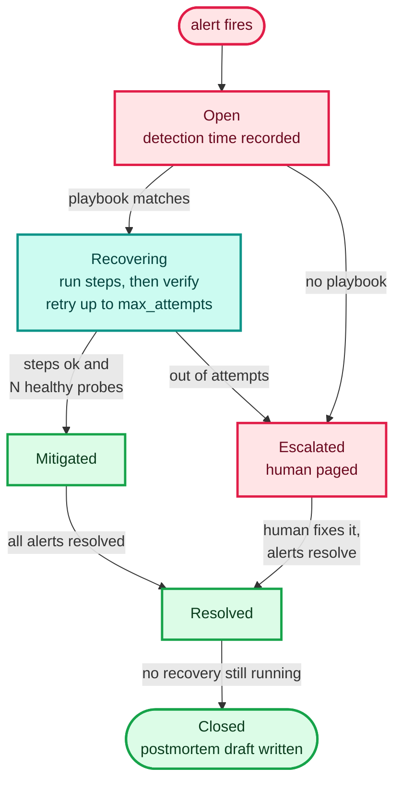

# Schematics: 08-disaster-recovery-autopilot

Diagrams are Mermaid, so GitHub renders them inline below. Each also has a rendered `.svg` next to its
`.mmd` source. Edit the `.mmd` file, then run `python3 scripts/build_schematics.py` from the repository root.

## System architecture

Two ways in: Prometheus and Alertmanager post to the responder's webhook, or the probe watcher turns a health endpoint into the same alert payloads. The responder opens an incident, picks the most specific playbook, runs its steps (commands without a shell, HTTP calls with secrets from the environment) and only calls the service recovered after consecutive healthy probes. When every alert in the incident has resolved, it renders a postmortem draft and can open it as a GitHub issue for review.

[SVG](01-architecture.svg) · [source](01-architecture.mmd)

## Incident lifecycle

The states an incident moves through. Repeated notifications for a firing alert do not re-run recovery. An incident closes only when every alert in it has resolved and no recovery is still running, so the postmortem always includes the full automation record. With no matching playbook, or after the last failed attempt, the incident is escalated, and the draft says so and proposes the follow-up.

[SVG](02-incident-lifecycle.svg) · [source](02-incident-lifecycle.mmd)
