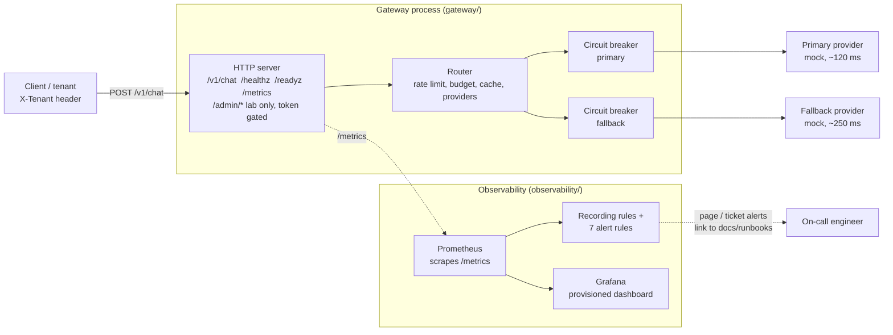
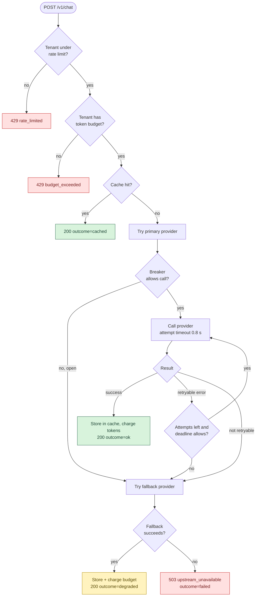
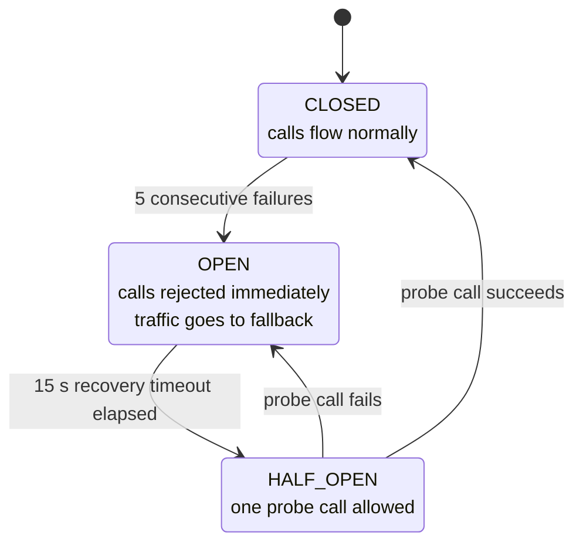
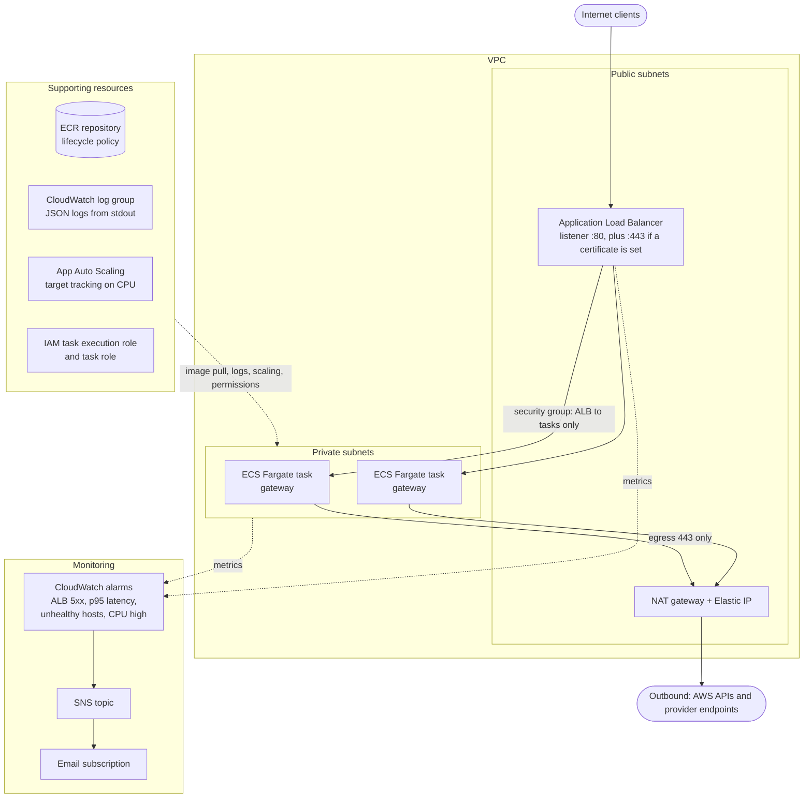
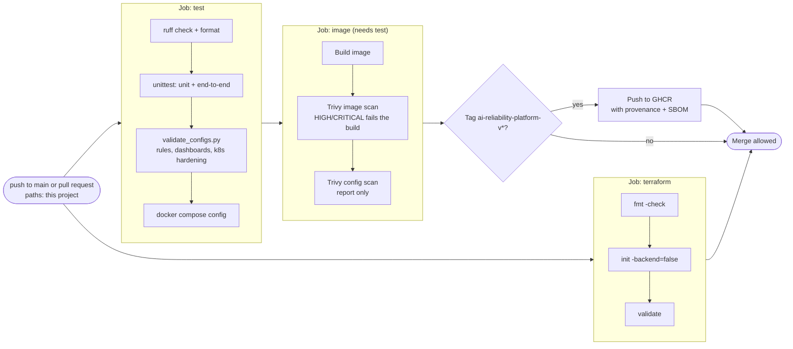

# Schematics: ai-reliability-platform

Diagrams are Mermaid, so GitHub renders them inline below. Each also has a rendered `.svg` next to its
`.mmd` source. Edit the `.mmd` file, then run `python3 scripts/build_schematics.py` from the repository root.

## System architecture

What runs where. The gateway is one stdlib Python process; Prometheus scrapes it and evaluates the SLO rules in observability/rules/slo.yml, Grafana reads Prometheus. Providers are mocks.

[SVG](01-architecture.svg) · [source](01-architecture.mmd)

## Request decision flow

The order of checks in gateway/router.py. Each terminal state is a label on gateway_requests_total, which the SLO is computed from. Defaults: 2.0 s request deadline, 0.8 s per attempt, 3 attempts per provider, full-jitter backoff (base 0.05 s, cap 0.4 s).

[SVG](02-request-flow.svg) · [source](02-request-flow.mmd)

## Circuit breaker states

gateway/resilience.py. Defaults from gateway/config.py: 5 consecutive failures to open, 15 s before a probe. A provider rejecting a bad request counts as a success, because it is not a health signal. The numeric state is exported as gateway_circuit_state, and the PrimaryProviderCircuitOpen alert fires when the primary stays in state 2 (open) for 1 minute.

[SVG](03-circuit-breaker.svg) · [source](03-circuit-breaker.mmd)

## AWS deployment (Terraform)

What terraform/ declares. Not applied in the build environment, so treat it as reviewed but unproven. Without a certificate_arn the ALB forwards plain HTTP on port 80; with one it serves HTTPS on 443 and port 80 redirects to it (301). Tasks run in private subnets and reach the outside world only through the NAT gateway on port 443.

[SVG](04-aws-deployment.svg) · [source](04-aws-deployment.mmd)

## Delivery pipeline (GitHub Actions)

.github/workflows/ai-reliability-platform.yml at the repository root. The three jobs run on every push to main and pull request touching this project; the image job waits for tests. Only a tag named ai-reliability-platform-vX.Y.Z publishes to GHCR.

[SVG](05-delivery-pipeline.svg) · [source](05-delivery-pipeline.mmd)
