# 2 · Reliability and recovery

**Three answers to the same question: what happens when it breaks?** A gateway that keeps serving while a
provider is down, a lab that states reliability as numbers and rehearses failure against them, and an
autopilot that drives the recovery and writes the postmortem draft with the timeline it actually observed.

Built from [05](../projects/05-ai-reliability-platform) · [07](../projects/07-sre-reliability-lab) ·
[08](../projects/08-disaster-recovery-autopilot)

## Stay up · [05 AI reliability platform](../projects/05-ai-reliability-platform)

An AI-backed service built so the chat endpoint is the least interesting part. Retries use full jitter and
deadlines; each provider sits behind its own circuit breaker with a half-open probe; a fallback provider takes
over when the primary opens; per-tenant rate limits and budget caps stop one noisy tenant from spending
everyone's capacity, and a cache absorbs repeats.

**Measured:** in a simulated total outage of the primary, all 180 requests still succeeded through the
fallback and the circuit closed again by itself on recovery. Failing over costs latency — about 290 ms at the
median against about 140 ms healthy — and that trade is the point: a slower answer beats no answer. It is a
single local run demonstrating behaviour, not a capacity benchmark, and the providers are mocks.

## Prove it · [07 SRE reliability lab](../projects/07-sre-reliability-lab)

One SLO file is the source of truth for the Prometheus recording rules, the burn-rate thresholds and the
error-budget maths. A simulator replays incidents through those alert policies, and a chaos runner injects
faults against a live demo service and writes a game-day report.

**Measured:** a 5% error rate held for 30 minutes pages after 18 minutes, having already spent 2.2% of the
monthly budget. The delay is the price of the one-hour window and is worth defending rather than hiding — it
is what stops a blip from waking someone. Both game-day hypotheses held. The reports also record flaws found
in the chaos runner itself, including an untested blast-radius claim and a "recovery time" that was really
just the window length.

## Recover · [08 Disaster recovery autopilot](../projects/08-disaster-recovery-autopilot)

`drpilot` takes alerts from the monitoring in project 04, opens an incident, runs the matching recovery
playbook, and only calls a service recovered after consecutive healthy probes **and** passing data checks.
When the incident closes it writes a postmortem draft with the timeline, every step and its output, and
whether the declared RTO and RPO were met.

It deliberately refuses to guess. Root cause, plain-language impact and action-item owners are left as
explicit `TODO (human)` sections, because an automated postmortem that invents a root cause is confident
fiction.

**Measured:** 85 tests against a real PostgreSQL 16 server, and three disaster-recovery drills whose
postmortem drafts are committed — a clean restore, a poisoned backup that was skipped, and a rotted backup
that was refused and escalated rather than restored.

## Proven

All three workflows run on GitHub and pass: 40 tests plus an image build and HIGH/CRITICAL scan for 05;
33 tests including live chaos experiments against the running demo service, plus `promtool check rules`, for
07; and lint, playbook validation and the 85-test real-PostgreSQL suite for 08. CI also runs 08's three
recovery drills end to end on every change and keeps their postmortem drafts as build artifacts. The 05
provider-outage drill is the one result produced locally, and its evidence is committed.

## Not proven

CI syntax-checks 07's and 08's alert rules with `promtool check rules`, which proves they parse — not that
they fire correctly. No Prometheus has evaluated them against real series. The Terraform for 08's backup
bucket has not been applied, and no part of this has run against real AWS.
