# 3 · Developer platform

**Make the secure, reliable path the easiest path, and make deviations visible.** A developer runs one
command and gets a production-shaped service: code, tests, a hardened container, Kubernetes manifests, a CI
pipeline and a runbook. The guardrails are code, so the same rules that shape a new service also audit an old
one.

Built from [06](../projects/06-self-service-platform)

## What `platformctl` does

| Command | Result |
|---|---|
| `platformctl new` | Scaffolds a service that already passes every policy: pinned image, resource limits, non-root, readiness probe, ownership labels, plus its own tests and runbook |
| `platformctl validate` | Checks any repository against numbered rules (`K8S001` to `K8S011` and friends) and reports findings by rule ID, so a failure tells you exactly which guardrail it hit |
| `platformctl env add` | Turns a cloud environment request into a reviewable Terraform pull request: an image repository with immutable tags and scan-on-push, a deploy role assumed through OIDC rather than stored keys, a log group and a monthly budget alert |
| `platformctl catalog` | Builds a service catalog from every `service.yaml`, so what exists and who owns it is answerable |

Services declare a reliability tier, and the tier decides the defaults: `critical` gets three replicas, a
disruption budget of two and a 99.95% objective, down to `best-effort` at one replica and 99.0%.

## Why the tests are the interesting part

Each policy rule has a mutation test: it breaks exactly one thing and expects the checker to name that rule.
A freshly scaffolded service must pass policy at **every** tier, and the generated service's own test suite
must pass. That turns the scaffolding from a template into something with a contract.

## Proven

The workflow runs on GitHub and passes: 32 tests, the full scaffold → validate → generated-tests round trip,
and Terraform checks on the module and the example environments.

## Not proven

The Terraform module has never been applied to a real AWS account. There is no portal UI — a Backstage plugin
or a web form could sit on top of the CLI. And this is a small purpose-built checker, not a replacement for
OPA, Kyverno or Conftest at scale.

## Personal-account defaults

The registry (`ghcr.io/joxejaime`) and the generated `CODEOWNERS` owner (`@Joxejaime`) default to this personal
account. GitHub team handles (`@org/team`) only exist inside an organization, so inside one you would scaffold
with `--code-owner @<org>/<team>` and `--registry` pointing at the organization's registry.
